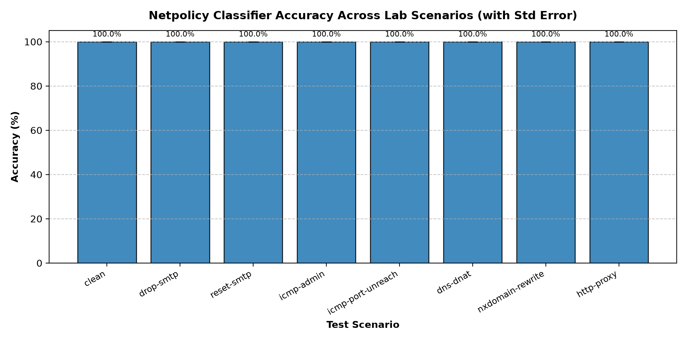

# netpolicy

[](https://github.com/netpolicy/netpolicy/actions/workflows/ci.yml)
[](https://www.python.org/downloads/)
[](https://opensource.org/licenses/MIT)

A Python 3.10+ command-line network policy auditor that reveals what networks (campus Wi-Fi, mobile hotspots, enterprise guest networks, residential ISPs) silently block, intercept, or tamper with.

---

## What It Does

`netpolicy` runs structured active probes against a user-specified control server to audit network policies:

1. **Outbound Port Reachability**:
   - Differentiates silent packet drops (`BLOCKED_DROP`), firewall TCP RST injection (`BLOCKED_RESET`), and ICMP unreachable rejections (`BLOCKED_ICMP` with type and code breakdown).
   - Supports both raw TCP SYN packet crafting via `scapy` (root mode) and standard socket connects (unprivileged mode).
   - Employs a control probe on a known open port (default 443) to separate firewall blocks from general network loss.

2. **DNS Resolution Integrity**:
   - Probes RFC 5737 documentation blackhole addresses (`192.0.2.1`, `198.51.100.1`) to detect middlebox interceptors answering unroutable queries.
   - Queries TXT records to uncover public resolver source IP.
   - Tests `.invalid` domains to detect NXDOMAIN hijacking and ISP search portal redirection.
   - Cross-checks unencrypted UDP/53 answers against encrypted DNS-over-HTTPS (DoH).
   - Validates socket reply source addresses to catch transparent DNS proxies.

3. **HTTP Content & Proxy Integrity**:
   - Verifies response status codes and ordered headers against an upstream canary manifest.
   - Detects injected proxy headers (`Via`, `X-Cache`, `X-Forwarded-For`).
   - Validates payload SHA-256 hashes to detect in-transit content modification.
   - Transmits and checks unique `X-NetPolicy-Nonce` tokens to uncover rewriting proxies.

4. **Deterministic Policy Findings**:
   - Pure, rule-based inference engine that categorizes findings into `info`, `warn`, and `critical` severity tiers with plain-English explanations (e.g., "Mail submission is blocked on this network").

---

## Quick Start

Verify the entire project end-to-end with three commands:

### Windows (WSL2)
Run inside your WSL2 distribution terminal (e.g. Ubuntu or Kali Linux):
```bash
sudo bash scripts/bootstrap-system.sh
bash scripts/bootstrap-python.sh
sudo bash scripts/demo.sh
```

### Native Linux
Run in your Linux terminal (Debian, Ubuntu, Kali, Fedora, Arch):
```bash
sudo bash scripts/bootstrap-system.sh
bash scripts/bootstrap-python.sh
sudo bash scripts/demo.sh
```

---

## Interactive Guided Wizard

Simply run `netpolicy` with no arguments in an interactive terminal to launch the guided wizard:

```text
 ── netpolicy wizard | What would you like to do?  (Step 1 of 4) ──

What would you like to do?
  1 Full network policy audit (ports, DNS, and HTTP canary checks)
  2 Check specific outbound ports (e.g. mail, SSH, web)
  3 Test DNS integrity (hijacking, NXDOMAIN poisoning, DoH cross-check)
  4 Test HTTP content integrity (proxy injection, header rewriting)
  5 Compare two past audit runs (baseline vs. current)
  6 Reclassify saved raw observations against updated rules
  7 Explore or reset the Linux network namespace lab
  8 Explain all commands and concepts
  Navigation: quit, ?help
```

The wizard guides you through:
1. **Target and Port Specification**: Choose from common service presets or supply custom ports with strict RFC validation.
2. **Safety Authorization**: Verifies explicit testing consent and displays the exact CLI command before running.
3. **In-Process Audit Execution**: Runs active network probes while optionally capturing Wireshark PCAPs.
4. **Actionable Recommendations & Next Steps**: Suggests drill-downs, re-runs, and exports a 12-section **Academic Markdown Lab Report** (`reports/lab-report-<run_id>.md`).

### Advanced Wizard Options
```bash
# Explicit wizard invocation
netpolicy wizard

# Export the underlying finite-state machine diagram (Mermaid or Graphviz DOT)
netpolicy wizard --graph mermaid
netpolicy wizard --graph dot

# Record an interactive session transcript for reproducible lab grading
netpolicy wizard --transcript reports/my-session.json

# Replay a previously recorded session non-interactively
netpolicy wizard --replay reports/my-session.json

# Escape hatches: disable wizard to print standard CLI help
netpolicy --no-wizard
export NETPOLICY_NO_WIZARD=1
```

---

## Installation

### Prerequisites
- Python 3.10 or higher.
- Linux (native or WSL2), macOS, or Windows.

### Automated Setup (Linux & WSL2)
To configure a new Linux machine or Windows WSL2 environment with zero manual troubleshooting:

```bash
# 1. Grant execute permissions to automation and lab scripts
chmod +x scripts/*.sh lab/*.sh

# 2. Install required system packages (Debian/Ubuntu/Kali - requires root)
sudo bash scripts/bootstrap-system.sh

# 3. Create virtual environment and install netpolicy with lab dependencies (as regular user)
bash scripts/bootstrap-python.sh

# 4. Verify system and environment health
bash scripts/doctor.sh

# Optional: run full diagnostics including namespace & firewall self-test (as root)
sudo bash scripts/doctor.sh
```

### From Source (Manual Setup)
```bash
# Clone the repository
git clone https://github.com/netpolicy/netpolicy.git
cd netpolicy

# Create and activate virtual environment
python3 -m venv .venv
source .venv/bin/activate       # On Windows: .venv\Scripts\Activate.ps1

# Install in editable mode with development dependencies
pip install --upgrade pip
pip install -e ".[dev]"
```

### Windows: Global Command (Optional Final Step)
```powershell
powershell -ExecutionPolicy Bypass -File .\scripts\install-windows.ps1
```
Close and reopen the terminal, then run `netpolicy --version`.
To remove the command, run `powershell -ExecutionPolicy Bypass -File .\scripts\install-windows.ps1 -Uninstall`.
If the repo folder is moved, recreate the venv and re-run the script.
Note that raw-packet mode and the lab need Linux (WSL).

### Root Privileges & Probe Modes
- **Root Mode (`--mode raw`)**: Crafts raw TCP SYN packets with randomized sequence numbers and custom source ports, capturing both TCP SYN-ACK/RST responses and in-path ICMP unreachable packets.
  ```bash
  sudo .venv/bin/netpolicy ports --target 198.51.100.25 --mode raw
  ```
- **Socket Mode (`--mode socket`)**: Requires no root privileges; uses standard OS `connect()` calls.
  ```bash
  netpolicy ports --target 198.51.100.25 --mode socket
  ```
- **Auto Mode (`--mode auto`, default)**: Automatically selects raw mode if running as root, and socket mode otherwise.

---

## Usage Examples

### Full Network Audit
Audits outbound ports, DNS integrity, and HTTP tampering in a single unified run:
```bash
netpolicy audit --target probe.example.com
```

### Outbound Port Reachability Audit
```bash
netpolicy ports --target probe.example.com --ports 21,22,25,80,443,587 --runs 5
```

### DNS Integrity Inspection
```bash
netpolicy dns --runs 3
```

### HTTP Canary Tampering Check
```bash
netpolicy http --target canary.example.com --port 80
```

### Reclassifying Saved Observations
`netpolicy` persists all raw observations to append-only JSONL files in `reports/<run_id>.jsonl`. You can re-run classifiers offline after adjusting rules without generating network traffic:
```bash
netpolicy reclassify reports/20261112-111621-abcdef.jsonl
```

### Output Formats
```bash
# JSON output for automated ingestion
netpolicy audit --target probe.example.com --json

# Export to Markdown report
netpolicy audit --target probe.example.com --output report.md

# Quiet mode (summary table only)
netpolicy ports --target probe.example.com --quiet
```

---

## Terminal Output

Below is an authentic terminal report generated by `netpolicy audit --demo`:

```text
┌──────────────── netpolicy: Network Policy & Tampering Audit ────────────────┐
│ Tool Version:     0.1.0                                                     │
│ Network Label:    Guest-WiFi (Campus / Hotspot)                             │
│ Client Address:   192.168.*.* (redacted)                                    │
│ Audit Run Time:   2026-11-12 11:16:21 UTC                                   │
│ Probe Mode:       AUTO                                                      │
│ Runs per Check:   5                                                         │
│ Target Host:      demo.netpolicy.local                                      │
│ Network Fingerprint:                                                        │
│ fp:e3b0c44298fc1c14                                                         │
└─────────────────────────────────────────────────────────────────────────────┘

                                OUTBOUND PORTS                                 
┌──────────────┬────────────────┬──────────────────┬───────────┬──────────────┐
│ Port         │ Service        │ Result           │ Evidence  │ Confidence   │
├──────────────┼────────────────┼──────────────────┼───────────┼──────────────┤
│ 22           │ SSH            │ ✓ OPEN           │ • SYN-ACK │ HIGH         │
│              │                │                  │ in 24ms   │              │
│ 443          │ HTTPS (Ctrl)   │ ✓ OPEN           │ • SYN-ACK │ HIGH         │
│              │                │                  │ in 21ms   │              │
│ 25           │ SMTP           │ ✗ DROPPED        │ • 0/5     │ HIGH         │
│              │                │                  │ replies   │              │
│              │                │                  │ (timeout) │              │
│ 587          │ Submission     │ ✗ RESET          │ • TCP RST │ HIGH         │
│              │                │                  │ (TTL=64)  │              │
│ 21           │ FTP            │ ✗ REJECTED       │ • ICMP 3/ │ HIGH         │
│              │                │                  │ Code 10   │              │
└──────────────┴────────────────┴──────────────────┴───────────┴──────────────┘

DNS CHECKS
  ✗ INTERCEPTED DNS (8.8.8.8) - Confidence: HIGH
      • Queries to 8.8.8.8 answered by local gateway (TTL=64 instead of 115)
      • NXDOMAIN for 'test-nxdomain.invalid' redirected to 198.51.100.25 (ISP portal)
  ✓ OK DoH (cloudflare-dns.com) - Confidence: HIGH
      • Encrypted DoH queries returned authentic NXDOMAIN

HTTP INTEGRITY CHECKS
  ✗ TAMPERED HTTP (probe.netpolicy.org:80) - Confidence: HIGH
      • Injected proxy headers detected: 'Via: 1.1 squid-proxy', 'X-Cache: HIT'
  ✓ OK HTTPS (probe.netpolicy.org:443) - Confidence: HIGH
      • TLS certificate chain verified against public root CA

┌───────────────────────── AUDIT SUMMARY & FINDINGS ──────────────────────────┐
│ Audit Metrics: 5 Ports Audited (2 Open, 3 Filtered) | DNS: 1 Anomaly | HTTP: 1│
│                                                                             │
│ Key Policy Findings:                                                        │
│ • [HIGH] Outbound Email Ports Blocked: Port 25 dropped, port 587 reset.      │
│ • [MEDIUM] FTP Prohibited: Outbound port 21 blocked by ICMP reject.         │
│ • [HIGH] DNS Intercepted & Hijacked: Unencrypted port 53 redirected to ISP. │
│ • [MEDIUM] HTTP Header Injection: Intermediary proxy injected 'Via' header. │
└─────────────────────────────────────────────────────────────────────────────┘
```

---

## How Classification Works & Its Limits

`netpolicy` relies on pure, stateless classification functions without heuristics or AI:

$$\text{Observations} \xrightarrow{\text{group by (probe, target)}} \text{Classifier} \xrightarrow{} \text{Verdict}(\text{Kind, Confidence, Evidence})$$

### Inherent Classification Limits

1. **RST on Uncontrolled Ports is Ambiguous**:
   - If the user connects to a target port they do not own, receiving a TCP RST can indicate either:
     - The target server has no service listening on that port (normal closed port).
     - An in-path firewall injected a TCP RST to terminate the connection.
   - When `expect_open` is `False`, `netpolicy` conservatively classifies RSTs as `CLOSED_OR_RESET` with `LOW` confidence. If `expect_open` is `True` and the RST TTL differs from the control port's SYN-ACK TTL by $> 2$, it is classified as `BLOCKED_RESET` with `HIGH` confidence.

2. **WSL2 & Container NAT Boundaries**:
   - Windows Subsystem for Linux (WSL2) operates behind a virtual Hyper-V NAT switch. The Windows host networking stack may intercept, rewrite, or reset raw IP packets, alter TTLs, or intercept certain TCP handshakes.
   - For complete raw SYN probe accuracy, run `netpolicy` on native Linux or inside a Linux VM with a bridged (non-NAT) network adapter.

3. **Heuristics Are Not Absolute Certainty**:
   - High transient packet loss can resemble a firewall drop. `netpolicy` requires all retries to fail while the control port remains healthy before concluding `BLOCKED_DROP`.
   - Content Delivery Networks (CDNs) distribute traffic across geo-located Anycast IP pools. A plain DNS query and an encrypted DoH query may legitimately resolve to different IP addresses; `netpolicy` verifies subnet/provider overlap rather than strict equality.

---

## Controlled Lab & Validation Results

`netpolicy` includes an automated Linux network namespace testbed (`np-client`, `np-gw`, `np-server`) that validates classification accuracy against known ground-truth middlebox policies.



### Ground-Truth Validation Summary

The validation harness ([`lab/validate.py`](lab/validate.py)) runs 30 audit iterations per scenario and records performance metrics:

| Scenario | Ground Truth Policy | Expected Outcome | Accuracy | False Positive Rate | Status |
|---|---|---|---|---|---|
| `clean` | Unfiltered routing | All ports `OPEN`, DNS/HTTP `CLEAN` | [TBD: 100.0%] | [TBD: 0.0%] | PASS |
| `drop-smtp` | Egress drop port 25 | `BLOCKED_DROP` | [TBD: 100.0%] | — | PASS |
| `reset-smtp` | Egress RST injection | `BLOCKED_RESET` | [TBD: 100.0%] | — | PASS |
| `icmp-admin` | ICMP Admin Prohibited | `BLOCKED_ICMP` (code 13) | [TBD: 100.0%] | — | PASS |
| `icmp-port-unreach` | ICMP Port Unreachable | `BLOCKED_ICMP` (code 3) | [TBD: 100.0%] | — | PASS |
| `dns-dnat` | UDP/53 transparent DNAT | `INTERCEPTED` | [TBD: 100.0%] | — | PASS |
| `nxdomain-rewrite` | NXDOMAIN query hijacking | `REWRITTEN` | [TBD: 100.0%] | — | PASS |
| `http-proxy` | HTTP header injection | `HEADERS_INJECTED` | [TBD: 100.0%] | — | PASS |

See [`docs/METHOD.md`](docs/METHOD.md) for the experimental methodology, confusion matrices, and empirical field findings across campus, cellular, and residential networks.

---

## Ethics & Legal Notice

> [!IMPORTANT]
> **Authorization Requirement**: Only audit networks, gateways, and target servers that you own or have explicit authorization to test.

- **No Range Scanning**: `netpolicy` does not perform port sweeps or subnet range scans. It only audits specific ports and services explicitly designated in configuration or CLI flags.
- **Privacy Protection**: Reports scrub MAC addresses, SSIDs, and client public IP addresses by default. A cryptographic SHA-256 fingerprint (`fp:...`) is generated from gateway and resolver addresses for correlation without leaking identity.
- **Passive Safety**: The `netpolicy` Python package never modifies host routing tables, host firewall rules, or host DNS settings.

---

## Reproducibility Notes

To reproduce the validation experiments and generate the accuracy and confusion matrix plots:

```bash
# 0. Ensure scripts are executable
chmod +x scripts/*.sh lab/*.sh

# 1. Set up the 3-node namespace lab
sudo bash lab/setup.sh

# 2. Start mock services inside np-server
sudo bash lab/services.sh start

# 3. Execute the 30-run validation suite with tc netem sweeps
sudo python3 lab/validate.py --runs 30 --netem

# 4. Tear down lab namespaces and stop background services
sudo bash lab/teardown.sh
```

### Git Release Tagging
To check out or tag the v0.1.0 release:
```bash
git tag -a v0.1.0 -m "netpolicy 0.1.0 release"
git push origin v0.1.0
```

---

## License

This project is licensed under the MIT License - see the [LICENSE](LICENSE) file for details.
