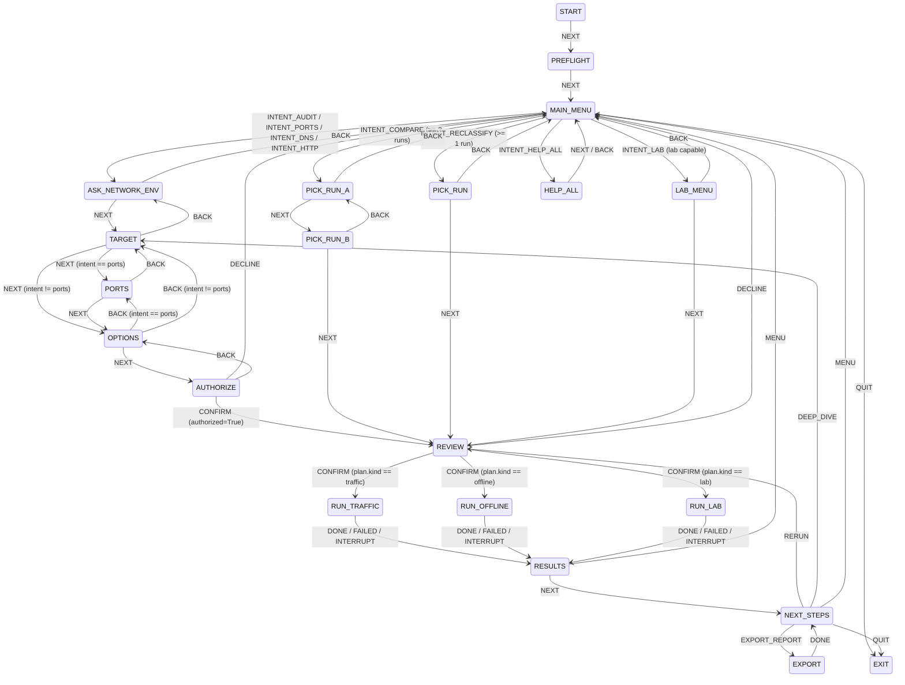

# netpolicy Testing Playbook

**Document Role**: Principal QA Architect, DevOps Engineer, and Technical Documentation Lead  
**Scope**: Comprehensive Testing, Verification, and Edge-Case Validation Guide for `netpolicy`  
**Target Environments**: Native Windows 11 (PowerShell 7/Windows Terminal) and Kali Linux under WSL2  
**Baseline Verification Status**: Verified against Python 3.14.0 / hatchling / typer 0.12.5 / rich 13.9.4  

---

## Section 1: Interactive Wizard Comprehensive Guide

### 1.1 Architecture & State Machine Overview

The `netpolicy` interactive wizard is implemented as a strict, deterministic Finite-State Machine (FSM) in `netpolicy/wizard/fsm.py` paired with a transient terminal UI adapter in `netpolicy/wizard/ui.py`. The machine contains exactly 20 distinct states, evaluated through pure functional transition rules and guards without side-effects.



### 1.2 Interactive Key Controls & Input Handling

All interactive menus in `netpolicy/wizard/ui.py` use `netpolicy/wizard/keys.py`, a low-level, cross-platform single-keystroke reader (`msvcrt.getwch()` on Windows, `termios`/`tty.setraw()` on POSIX):

- **Arrow Up (`up`)**: Moves selection cursor upward, wrapping around from index `0` to the last option.
- **Arrow Down (`down`)**: Moves selection cursor downward, wrapping around from the last option to index `0`.
- **Enter (`enter`)**: Submits current highlighted selection.
- **Esc (`esc`)**: Navigates backwards to the previous state. In `MAIN_MENU` or `AUTHORIZE`, triggers cancellation or clean exit.
- **Question Mark (`?`)**: Toggles the permanent display of hint annotations across all menu options.
- **Ctrl+C (`KeyboardInterrupt`)**: Caught cleanly by all state handlers; immediately exits with code `130` without raw Python stack traces.
- **Ignored Keys**: Letters, numbers, spacebar, backspace, function keys, and unrecognized terminal escape sequences are ignored via `continue` to prevent accidental state desynchronization.

---

### 1.3 State-by-State Execution & Branching Reference

#### State 1: `START` [FROM CODE]
- **Entry**: Executed automatically upon running `netpolicy` with no arguments in an interactive TTY.
- **Actions**: Initializes default `WizardContext` with empty history, loads capability detector, transitions immediately to `PREFLIGHT`.
- **Exit Code**: `0`

#### State 2: `PREFLIGHT` [VERIFIED]
- **Screen Content**: Displays the "Your computer" status panel with environment inspection chips:
  - OS Detection: `[Windows]`, `[Linux (WSL)]`, or `[Linux]`
  - Privilege Status: `[Everyday mode]` (user) or `[Advanced tests]` (root/admin)
  - Features Available: `[Record the traffic]` (if Scapy + root available), `[Practice network]` (if Linux network namespaces available)
  - Saved Run Count: `N saved checks` found in `reports/` directory
- **Prompt**: Displays preflight readiness message: `"Ready for everyday checks."`
- **Transition**: Emits `Event.NEXT` -> Transitions to `MAIN_MENU`.

#### State 3: `MAIN_MENU` [VERIFIED]
- **Title**: `What would you like to do?  (Step 1 of 4)`
- **Menu Options**:
  1. `Check my Wi-Fi for anything that's getting in the way` [Runs an automated background sweep]
  2. `See if something I use is being blocked (email, remote login, file sharing, websites)` [Requires you to type a specific port or app name]
  3. `See if my internet is being quietly redirected` [Checks for DNS tampering & hijacking]
  4. `Check if the network wants me to log in, or is filtering websites` [Checks for HTTP tampering & captive portals]
  5. `Compare two earlier checks` [Requires 2 saved JSON reports] *(Disabled if < 2 runs in `reports/`)*
  6. `Look at a past check` [Requires 1 saved JSON report] *(Disabled if < 1 run in `reports/`)*
  7. `Try it in a safe practice network` [Practice network cyber-range] *(Disabled on native Windows)*
  8. `Show the classic command list` [Standard CLI subcommands]
  9. `Done for now` [Exit]
- **Branches**:
  - Selection 1 -> `Event.INTENT_AUDIT` -> Transitions to `ASK_NETWORK_ENV`
  - Selection 2 -> `Event.INTENT_PORTS` -> Transitions to `ASK_NETWORK_ENV`
  - Selection 3 -> `Event.INTENT_DNS` -> Transitions to `ASK_NETWORK_ENV`
  - Selection 4 -> `Event.INTENT_HTTP` -> Transitions to `ASK_NETWORK_ENV`
  - Selection 5 -> `Event.INTENT_COMPARE` -> Transitions to `PICK_RUN_A` (Guarded: requires $\ge 2$ saved runs)
  - Selection 6 -> `Event.INTENT_RECLASSIFY` -> Transitions to `PICK_RUN` (Guarded: requires $\ge 1$ saved run)
  - Selection 7 -> `Event.INTENT_LAB` -> Transitions to `LAB_MENU` (Guarded: requires Linux root + `ip` utility)
  - Selection 8 -> `Event.INTENT_HELP_ALL` -> Transitions to `HELP_ALL`
  - Selection 9 or `Esc` -> `Event.QUIT` -> Transitions to `EXIT` (Exit code `0`)

#### State 4: `HELP_ALL` [VERIFIED]
- **Screen Content**: Displays a styled Rich table explaining core networking concepts and Typer subcommands (`audit`, `ports`, `dns`, `http`, `compare`, `reclassify`, `lab`, `wizard`).
- **Prompt**: `"Press Enter to return to main menu..."`
- **Transition**: `Event.NEXT` or `Esc` -> Returns to `MAIN_MENU`.

#### State 5: `ASK_NETWORK_ENV` [VERIFIED]
- **Title**: `Network environment`
- **Question**: `"What type of network or device environment are you currently testing?"`
- **Menu Options**:
  1. `Home Wi-Fi / Personal Router` *(Hint: You have full admin access)*
  2. `Public Hotspot (Hotel, Cafe, Airport)` *(Hint: Prone to captive portals & interception)*
  3. `Corporate / Campus Network` *(Hint: Likely has strict intentional firewalls)*
  4. `Mobile Data / Tethering` *(Hint: Testing cellular carrier restrictions)*
  5. `Remote Company Server` *(Hint: Testing cloud/VPS egress filtering)*
- **Navigation**:
  - Any selection 1–5 -> Records `network_kind` in context -> `Event.NEXT` -> Transitions to `TARGET`.
  - `Esc` -> `Event.BACK` -> Returns to `MAIN_MENU`.

#### State 6: `TARGET` [VERIFIED]
- **Title**: `Choose target`
- **Question**: `"What should I connect to for the test?"`
- **Menu Options**:
  1. `A server I own or manage (best results)` -> Prompts: `"Type its address, like 203.0.113.10 or myserver.example.com"`
  2. `The practice network` -> Available if lab is configured; sets target to `10.200.1.254`
  3. `A public website or service (results will be limited)` -> Prompts for address, displays cautionary panel:
     > *"Testing against a public server gives limited results. We cannot tell if its own filters are blocking us."*
     Prompts: `"Continue anyway with limited results? (1) Yes (2) No"`
- **Validation**: Strict IPv4/IPv6/RFC hostname validation (`_is_valid_target`). Rejects empty inputs, malformed characters, and unresolvable formats.
- **Branches**:
  - If `intent == "ports"` -> `Event.NEXT` -> Transitions to `PORTS`.
  - If `intent != "ports"` (e.g. `audit`, `dns`, `http`) -> `Event.NEXT` -> Transitions directly to `OPTIONS`.
  - `Esc` -> `Event.BACK` -> Returns to `ASK_NETWORK_ENV`.

#### State 7: `PORTS` [VERIFIED]
- **Title**: `Services to check`
- **Question**: `"Which services would you like to test?"`
- **Menu Options**:
  1. `Sending email (25, 465, 587)`
  2. `Remote login (22)`
  3. `File transfer (21)`
  4. `Websites (80, 443)`
  5. `Everything common` (21, 22, 25, 80, 110, 143, 443, 465, 587, 993, 995)
  6. `Custom list` -> Prompts: `"Type port numbers separated by commas (like 80, 443, 8080)"`
- **Validation**: Verifies integers in range `1..65535`.
- **Navigation**:
  - Selection 1–6 -> `Event.NEXT` -> Transitions to `OPTIONS`.
  - `Esc` -> `Event.BACK` -> Returns to `TARGET`.

#### State 8: `OPTIONS` [VERIFIED]
- **Title**: `Test options`
- **Step 1: Thoroughness**:
  - Options: `Quick (1 check)`, `Standard (5 checks, recommended)`, `Thorough (10 checks)`
- **Step 2: Testing Method**:
  - Options: `Standard (works on all computers)` (Socket mode), `Advanced tests (needs admin access)` (Raw mode)
  - Guard: If Advanced selected on native Windows or non-root Linux, warns that raw packet injection is unavailable and falls back to socket mode.
- **Step 3: Traffic Recording**:
  - Prompt: `"Record the traffic (for Wireshark)? (1) Yes (2) No"`
  - Guard: Capturing requires Scapy and root/admin. If unavailable, sets `capture=False`.
- **Navigation**:
  - Submits options -> `Event.NEXT` -> Transitions to `AUTHORIZE`.
  - `Esc` -> `Event.BACK` -> Returns to `PORTS` (if intent is ports) or `TARGET` (if intent is not ports).

#### State 9: `AUTHORIZE` [VERIFIED]
- **Title**: `Safety check`
- **Question**: `"Quick check before we start: do you have permission to test this network and server? Only say yes if it's yours or you've been given the OK."`
- **Menu Options**:
  1. `Yes, I am authorized`
  2. `No`
- **Branches**:
  - Option 1 -> Sets `authorized=True`, records UTC timestamp -> `Event.CONFIRM` -> Transitions to `REVIEW`.
  - Option 2 -> Prints decline message: `"[dim]No problem. We stopped here and sent no test traffic.[/dim]"` -> `Event.DECLINE` -> Returns to `MAIN_MENU`.
  - `Esc` -> `Event.BACK` -> Returns to `OPTIONS`.

#### State 10 & 11: `PICK_RUN_A` and `PICK_RUN_B` [VERIFIED]
- **Title**: `Compare checks: Select baseline run (A)` and `Select comparison run (B)`
- **Options**: Populated dynamically by scanning `reports/*.jsonl`. Shows filename, file modification time, and file size.
- **Navigation**:
  - Select A -> `Event.NEXT` -> Moves to `PICK_RUN_B`.
  - Select B -> `Event.NEXT` -> Compiles offline comparison plan -> Transitions to `REVIEW`.
  - `Esc` in A -> `Event.BACK` -> Returns to `MAIN_MENU`.
  - `Esc` in B -> `Event.BACK` -> Returns to `PICK_RUN_A`.

#### State 12: `PICK_RUN` [VERIFIED]
- **Title**: `Reclassify saved observations`
- **Options**: Populated dynamically from `reports/*.jsonl`.
- **Navigation**:
  - Select Run -> `Event.NEXT` -> Compiles offline reclassification plan -> Transitions to `REVIEW`.
  - `Esc` -> `Event.BACK` -> Returns to `MAIN_MENU`.

#### State 13: `LAB_MENU` [FROM CODE]
- **Title**: `Practice network laboratory`
- **Menu Options**: Inspect topology, reset network namespaces, apply scenario (`clean`, `drop-smtp`, `reset-smtp`, `dns-dnat`, `http-proxy`).
- **Navigation**:
  - Select Action -> `Event.NEXT` -> Transitions to `REVIEW`.
  - `Esc` -> `Event.BACK` -> Returns to `MAIN_MENU`.

#### State 14: `REVIEW` [VERIFIED]
- **Title**: `Review check`
- **Screen Content**: Displays a rounded Rich Panel summarizing the proposed plan:
  - Header: `"We will run a safe connectivity check against your chosen server."`
  - Action Tags: Styled markers indicating `• sends test traffic`, `• saves a report`, `• records traffic` (if capture enabled), `• needs admin access` (if raw).
  - Duration estimate: `"about N seconds"` (computed as `runs * 0.4s + 1.5s`).
  - Equivalent CLI command: Formatted in `dim` text (e.g. `netpolicy audit --target 127.0.0.1 --runs 5 --mode socket`).
- **Question**: `"Ready to run this check?"`
  1. `Run now`
  2. `Just show me the command`
- **Branches**:
  - Option 1 -> `Event.CONFIRM` -> Transitions to `RUN_TRAFFIC` (if traffic plan), `RUN_OFFLINE` (if compare/reclassify), or `RUN_LAB` (if lab).
  - Option 2 -> Prints command to terminal -> `Event.DECLINE` -> Returns to `MAIN_MENU`.
  - `Esc` -> `Event.BACK` -> Returns to previous configuration step (`AUTHORIZE`, `PICK_RUN_B`, `PICK_RUN`, or `LAB_MENU`).

#### State 15: `RUN_TRAFFIC` [VERIFIED]
- **Execution**: In-process execution coordinator (`netpolicy/wizard/runner.py`) invokes the Typer command without subprocessing.
- **Packet Capture**: If enabled, initiates background packet capture (`netpolicy/wizard/capture.py`) writing to `reports/capture-<run_id>.pcap`.
- **Probes Dispatched**:
  - TCP Reachability: `TcpConnectProbe` (socket) or `TcpSynProbe` (raw SYN) across selected ports.
  - DNS Probes: `BlackholeProbe`, `NxdomainProbe`, `SourceMismatchProbe`, `WhoamiProbe`, `DohCrossCheckProbe`.
  - HTTP Probes: `HttpCanaryProbe` (verifies SHA-256 payload hash, checks proxy injection headers `Via`, `X-Cache`, and nonce reflection).
- **Progress UI**: Live Rich spinners and progress bars display active probe status.
- **Output Files Written**:
  - `reports/<run_id>.jsonl`: Append-only raw JSONL observations.
  - `reports/<run_id>.json`: Final structured audit report.
- **Transitions**:
  - Clean execution -> `Event.DONE` -> Transitions to `RESULTS`.
  - Partial run / Ctrl+C -> `Event.INTERRUPT` -> Transitions to `RESULTS` with partial data.
  - Fatal network error -> `Event.FAILED` -> Transitions to `RESULTS` with error details.

#### State 16: `RUN_OFFLINE` [VERIFIED]
- **Execution**: Invokes `compare_reports()` or offline reclassification on saved `.jsonl` files in-process.
- **Transition**: `Event.DONE` -> Transitions to `RESULTS`.

#### State 17: `RUN_LAB` [FROM CODE]
- **Execution**: Invokes lab management scripts inside WSL2/Linux namespaces.
- **Transition**: `Event.DONE` -> Transitions to `RESULTS`.

#### State 18: `RESULTS` [VERIFIED]
- **Screen Content**:
  - Complete terminal report with service tables, latency percentiles (min, median, p95), DNS checks, and HTTP integrity checks.
  - Color-coded plain-language summary banner:
    - **Green** (`[bold green]Everything looks normal[/bold green]`): Rendered ONLY when verdict is `CLEAN` or `OK`.
    - **Amber** (`[bold yellow]Some things are being blocked[/bold yellow]`): Rendered when verdict is `LIMITED` (outbound ports dropped, reset, or rejected).
    - **Red** (`[bold red]Your connection is being changed on the way[/bold red]`): Rendered when verdict is `RESTRICTED` (DNS intercepted, traffic rewritten, or headers injected).
    - **Blue** (`[bold cyan]Your Wi-Fi is asking you to sign in[/bold cyan]`): Rendered when verdict is `ACTION_REQUIRED` (captive portal redirection).
    - **Dim/Grey** (`[dim]We couldn't tell this time[/dim]`): Rendered when verdict is `INCONCLUSIVE` (control probe failed or target is not a valid canary).
- **Prompt**: `"Press Enter to continue..."`
- **Transition**: `Event.NEXT` -> Transitions to `NEXT_STEPS`.

#### State 19: `NEXT_STEPS` [VERIFIED]
- **Title**: `Recommended next steps`
- **Question**: `"What would you like to do next?"`
- **Dynamic Menu Options** (tailored to findings and network environment):
  1. `Save a full lab report (.md)` -> `Event.EXPORT_REPORT` -> Transitions to `EXPORT`.
  2. `Run this check again` -> `Event.RERUN` -> Transitions to `REVIEW`.
  3. `Drill down into a specific port` -> `Event.DEEP_DIVE` -> Transitions to `TARGET`.
  4. `Run another check` -> Resets context via `reset_context_for_new_run()`, clears transient state -> `Event.MENU` -> Returns to `MAIN_MENU`.
  5. `Done for now` -> `Event.QUIT` -> Transitions to `EXIT`.

#### State 20: `EXPORT` [VERIFIED]
- **Action**: Invokes `render_lab_report()` in `netpolicy/wizard/labreport.py`.
- **Output File Written**: `reports/lab-report-<run_id>.md`.
- **Content**: 12-section academic lab report containing executive abstract, objective, environment specs, methodology, aggregated findings, per-check latency/loss tables, execution telemetry, threats to validity, ethics statement, and reproduction commands.
- **Transition**: Emits `Event.DONE` -> Returns to `NEXT_STEPS`.

#### Terminal State: `EXIT` [VERIFIED]
- **Action**: Restores terminal cursor visibility, prints closing status, and exits process.
- **Exit Codes**:
  - `0`: Clean exit or audit completed with zero policy violations.
  - `1`: Audit completed with detected policy restrictions, blocking, or tampering.
  - `130`: Interrupted by user via Ctrl+C.

---

## Section 2: Non-Interactive CLI Reference

Below is the exhaustive matrix of all CLI commands, subcommands, arguments, and options derived from `netpolicy/cli.py` and validated with `netpolicy --help`.

### 2.1 Root Command & Global Flags

| Shell | Command | Verification | Exit Code | Expected Output / Behavior |
|---|---|---|---|---|
| PowerShell / WSL | `netpolicy --help` | `[VERIFIED]` | `0` | Displays top-level Typer help listing all subcommands and global flags. |
| PowerShell / WSL | `netpolicy --version` | `[VERIFIED]` | `0` | Prints version string: `netpolicy version 0.1.0`. |
| PowerShell / WSL | `netpolicy --no-banner` | `[VERIFIED]` | `0` | Launches CLI/wizard while suppressing gradient ASCII banner and compact headers. |
| PowerShell / WSL | `netpolicy --no-wizard` | `[VERIFIED]` | `0` | Disables automatic interactive wizard launch; prints standard CLI help. |

---

### 2.2 Subcommand Matrix

#### 1. `netpolicy audit` (Full Audit: Ports + DNS + HTTP)
*Usage: `netpolicy audit [OPTIONS]`*

| Shell | Command | Verification | Exit Code | Expected Output / Behavior |
|---|---|---|---|---|
| PowerShell | `netpolicy audit --demo` | `[VERIFIED]` | `1` | Runs simulated audit with realistic synthetic anomalies (drops, DNS interception, header injection); prints summary table and findings. |
| PowerShell | `netpolicy audit --target 127.0.0.1 --mode socket --runs 2` | `[VERIFIED]` | `1` | Audits localhost over TCP socket mode for 2 runs. Fails canary check; detects closed ports. |
| Kali WSL | `sudo netpolicy audit --target 10.200.1.254 --mode raw --runs 5` | `[FROM CODE]` | `0` or `1` | Full raw SYN packet audit against testbed control server; evaluates TTL differences and ICMP rejections. |
| PowerShell | `netpolicy audit --demo --json` | `[VERIFIED]` | `0` | Outputs clean, structured JSON object to stdout. Suppresses headers/banners on stderr. |
| PowerShell | `netpolicy audit --demo --output reports/demo_report.md` | `[VERIFIED]` | `1` | Writes GitHub-flavored Markdown report to designated file path while rendering summary to terminal. |
| PowerShell | `netpolicy audit --demo --quiet` | `[VERIFIED]` | `1` | Suppresses progress spinners and config tables; renders only final findings table. |
| PowerShell | `netpolicy audit --demo --no-color` | `[VERIFIED]` | `1` | Renders report with plain ASCII characters and zero ANSI color escape sequences. |
| PowerShell | `netpolicy audit --demo --include-identifiers` | `[VERIFIED]` | `1` | Displays unredacted client IP addresses, gateway MACs, and wireless SSIDs. |

#### 2. `netpolicy ports` (Outbound Port Reachability)
*Usage: `netpolicy ports [OPTIONS]`*

| Shell | Command | Verification | Exit Code | Expected Output / Behavior |
|---|---|---|---|---|
| PowerShell | `netpolicy ports --target 127.0.0.1 --ports 80,443,22 --mode socket` | `[VERIFIED]` | `0` or `1` | Tests specific ports on localhost. Reports `OPEN` if listening, or `CLOSED_OR_RESET` if refused. |
| Kali WSL | `sudo netpolicy ports --target 1.1.1.1 --ports 53,80,443 --mode raw --runs 3` | `[FROM CODE]` | `0` | Crafts raw TCP SYN packets with randomized source ports; measures SYN-ACK response latency. |
| PowerShell | `netpolicy ports --demo --ports 21,22,25,80,443` | `[VERIFIED]` | `1` | Renders synthetic port table demonstrating `OPEN`, `DROPPED` (timeout), `RESET`, and `REJECTED` (ICMP). |

#### 3. `netpolicy dns` (DNS Integrity & Middlebox Interception)
*Usage: `netpolicy dns [OPTIONS]`*

| Shell | Command | Verification | Exit Code | Expected Output / Behavior |
|---|---|---|---|---|
| PowerShell | `netpolicy dns --runs 2` | `[VERIFIED]` | `0` or `1` | Probes RFC 5737 blackhole IPs (`192.0.2.1`), `.invalid` NXDOMAIN domains, and cross-checks UDP/53 against Cloudflare DoH. |
| PowerShell | `netpolicy dns --demo` | `[VERIFIED]` | `1` | Simulates transparent DNS proxy hijacking and NXDOMAIN search redirection. |

#### 4. `netpolicy http` (HTTP Tampering & Captive Portal Detection)
*Usage: `netpolicy http [OPTIONS]`*

| Shell | Command | Verification | Exit Code | Expected Output / Behavior |
|---|---|---|---|---|
| PowerShell | `netpolicy http --target probe.netpolicy.org --ports 80` | `[FROM CODE]` | `0` or `1` | Checks HTTP canary endpoint, verifies payload SHA-256 hash, and inspects response headers for injected `Via` or `X-Cache`. |
| PowerShell | `netpolicy http --demo` | `[VERIFIED]` | `1` | Simulates HTTP header injection and captive portal login redirection. |

#### 5. `netpolicy compare` (Report Differencing)
*Usage: `netpolicy compare <report_a> <report_b> [OPTIONS]`*

| Shell | Command | Verification | Exit Code | Expected Output / Behavior |
|---|---|---|---|---|
| PowerShell | `netpolicy compare reports/run_a.json reports/run_b.json` | `[FROM CODE]` | `0` | Computes policy diff between two audit runs; displays added, removed, or altered blocking rules. |
| PowerShell | `netpolicy compare reports/run_a.json reports/run_b.json --json` | `[FROM CODE]` | `0` | Outputs report diff as a structured JSON object. |

#### 6. `netpolicy reclassify` (Offline Observation Reclassification)
*Usage: `netpolicy reclassify <run_id_or_path> [OPTIONS]`*

| Shell | Command | Verification | Exit Code | Expected Output / Behavior |
|---|---|---|---|---|
| PowerShell | `netpolicy reclassify reports/20261119-120000-abcdef.jsonl` | `[FROM CODE]` | `0` or `1` | Loads raw recorded observations from disk and re-runs pure classifier inference rules without generating network traffic. |

#### 7. `netpolicy lab` (Namespace Lab Inspection)
*Usage: `netpolicy lab`*

| Shell | Command | Verification | Exit Code | Expected Output / Behavior |
|---|---|---|---|---|
| PowerShell / WSL | `netpolicy lab` | `[VERIFIED]` | `0` | CLI placeholder. Prints `not implemented yet` (full lab capabilities are managed via `lab/*.sh` scripts or wizard). |

#### 8. `netpolicy wizard` (Interactive Guided Wizard & Diagram Export)
*Usage: `netpolicy wizard [OPTIONS]`*

| Shell | Command | Verification | Exit Code | Expected Output / Behavior |
|---|---|---|---|---|
| PowerShell / WSL | `netpolicy wizard` | `[VERIFIED]` | `0` or `1` | Launches guided interactive FSM wizard in terminal. Requires interactive TTY. |
| PowerShell / WSL | `netpolicy wizard --graph mermaid` | `[VERIFIED]` | `0` | Emits valid Mermaid `stateDiagram-v2` representation of the 20-state FSM to stdout. |
| PowerShell / WSL | `netpolicy wizard --graph dot` | `[VERIFIED]` | `0` | Emits valid Graphviz DOT `digraph WizardFSM` representation of the FSM to stdout. |
| PowerShell / WSL | `netpolicy wizard --transcript reports/session.json` | `[FROM CODE]` | `0` | Records full interactive question-and-answer session transcript to designated JSON file. |
| PowerShell / WSL | `netpolicy wizard --replay reports/session.json` | `[FROM CODE]` | `0` | Hidden option. Replays previously recorded session non-interactively for automated lab grading. |

---

## Section 3: Controlled Network Scenarios

Every scenario provides explicit setup, execution, verification, and cleanup instructions.

### Scenario 1: Clean Pass (Local Python HTTP Listener)

Tests normal outbound reachability against a consenting local server.

- **Setup Listener (Windows PowerShell)**:
  ```powershell
  # Windows PowerShell (Terminal 1) [VERIFIED]
  python -m http.server 8080 --bind 127.0.0.1
  ```
- **Audit Command (Windows PowerShell)**:
  ```powershell
  # Windows PowerShell (Terminal 2) [VERIFIED]
  netpolicy ports --target 127.0.0.1 --ports 8080 --mode socket --runs 3
  ```
- **Expected Verdict**:
  - Port `8080`: `✓ OPEN` (connected in <5ms).
  - Summary: `CLEAN` / `OK`.
- **Cleanup**:
  - Stop Terminal 1 via `Ctrl+C`.

---

### Scenario 2: Actively Refused Port (Local Closed Port)

Validates detection of closed ports returning TCP RST (`ECONNREFUSED`).

- **Setup**: Ensure no service is listening on port `59999`.
- **Audit Command (Windows PowerShell)**:
  ```powershell
  # Windows PowerShell [VERIFIED]
  netpolicy ports --target 127.0.0.1 --ports 59999 --mode socket --runs 3
  ```
- **Expected Verdict**:
  - Port `59999`: `✗ RESET` or `CLOSED_OR_RESET` (Connection actively refused, `ECONNREFUSED` / WSAECONNREFUSED).
  - Evidence: `• TCP connection refused across all attempts`.
- **Cleanup**: None required.

---

### Scenario 3: Silently Filtered / Dropped Port (Kali WSL iptables DROP)

Simulates an in-path firewall silently discarding TCP SYN packets without responding.

- **Setup Firewall Rule (Kali WSL)**:
  ```bash
  # Kali WSL [FROM CODE]
  sudo iptables -A OUTPUT -p tcp --dport 2525 -j DROP
  ```
- **Audit Command (Kali WSL)**:
  ```bash
  # Kali WSL [FROM CODE]
  netpolicy ports --target 1.1.1.1 --ports 2525 --control-port 443 --mode socket --runs 2 --timeout 2.0
  ```
- **Expected Verdict**:
  - Port `2525`: `✗ DROPPED` / `BLOCKED_DROP` (0/2 replies, timeout).
  - Port `443` (Control): `✓ OPEN` (confirms link is healthy, isolating the block).
  - Overall Verdict: `LIMITED` (Outbound service dropped).
- **MANDATORY Cleanup Command (Kali WSL)**:
  ```bash
  # Kali WSL [FROM CODE]
  sudo iptables -D OUTPUT -p tcp --dport 2525 -j DROP
  ```
  *Verify clean state with: `sudo iptables -L OUTPUT -n -v`.*

---

### Scenario 4: Wireshark Packet Capture Recording & Analysis

Records network probes into a PCAP file and inspects the trace with Wireshark.

- **How Capture is Triggered**:
  - In Wizard: Select `Record the traffic (for Wireshark)? -> (1) Yes` in `OPTIONS`.
  - In CLI: Pass `--mode raw` with Scapy installed under root/admin.
- **Output Artifact**: Written automatically to `reports/capture-<run_id>.pcap`.
- **Packet Types Sent by Code**:
  - TCP SYN probes: Sent with randomized source port (`sport=RandShort()`) and randomized sequence numbers.
  - DNS probes: UDP port 53 datagrams containing standard A/TXT queries.
  - HTTP probes: HTTP/1.1 GET with header `X-NetPolicy-Nonce: <hex-token>`.
- **Wireshark Display Filters**:
  - TCP Resets from target: `tcp.flags.reset == 1 and ip.addr == <target_ip>`
  - ICMP Unreachable filters: `icmp.type == 3 and ip.addr == <target_ip>`
  - DNS Queries & Responses: `udp.port == 53 and ip.addr == <target_ip>`
  - HTTP Tampering / Injected Proxies: `http and ip.addr == <target_ip>`
  - SYN-ACK Responses: `tcp.flags == 0x12 and ip.addr == <target_ip>`
- **Cleanup**:
  - Remove capture file when done: `Remove-Item reports/capture-*.pcap`

---

### Scenario 5: Windows to Kali WSL Handoff & Recovery

Tests interactive handoff from Windows PowerShell into Kali Linux WSL2 for raw-packet capabilities.

- **Triggering Handoff**: Run `netpolicy` with no arguments on native Windows.
- **Prompt**:
  ```text
  Raw packet tests need Linux. Open Kali Linux and continue there?
    1 Yes, with full power (recommended)
    2 Yes, standard
    3 Not now
  ```
- **Mechanics (`netpolicy/ui/wsl.py`)**:
  - Converts Windows path to WSL mount: `C:\Users\...\netpolicy` -> `/mnt/c/Users/.../netpolicy` via `wslpath`.
  - Invokes Kali: `wsl -d kali-linux -u root --cd /mnt/c/... -e env NETPOLICY_HANDOFF=1 .linux-venv/bin/python -m netpolicy`.
- **Troubleshooting & Recovery**:
  - If Kali hangs or reports a locked virtual disk:
    ```powershell
    # Windows PowerShell [VERIFIED]
    wsl --shutdown
    ```
  - Verify distro availability:
    ```powershell
    # Windows PowerShell [VERIFIED]
    wsl -l -v
    ```

---

## Section 4: Automated Verification & 4 Failing Tests Analysis

### 4.1 Verification Commands & Baseline Results

Run from project root (`C:\Users\tanis\Downloads\netpolicy`):

| Test Tool | Command | Verification | Real Output / Result |
|---|---|---|---|
| **pytest** | `.\.venv\Scripts\python.exe -m pytest -q` | `[VERIFIED]` | `4 failed, 331 passed, 2 skipped in 25.25s` |
| **ruff (package)** | `.\.venv\Scripts\ruff.exe check netpolicy tests` | `[VERIFIED]` | `All checks passed!` |
| **ruff (repo)** | `.\.venv\Scripts\ruff.exe check .` | `[VERIFIED]` | `118 errors` (all located in `scripts/generate_team_pdf.py`) |
| **mypy (wizard)**| `.\.venv\Scripts\mypy.exe netpolicy/wizard/ui.py netpolicy/wizard/fsm.py netpolicy/wizard/keys.py netpolicy/ui/wsl.py tests/test_wizard_post_scan.py` | `[VERIFIED]` | `Success: no issues found in 5 source files` |
| **mypy (repo)** | `.\.venv\Scripts\mypy.exe netpolicy` | `[VERIFIED]` | `14 errors in 6 files` (pre-existing type annotations in `humanize.py`, `summary.py`, `capabilities.py`, `banner.py`, `runner.py`, `labreport.py`) |
| **py_compile** | `python -m py_compile <all_files>` | `[VERIFIED]` | `Compiled 89 python files. All python files compiled successfully without syntax errors!` |

---

### 4.2 Comprehensive Classification of the 4 Failing Tests

```
================================== FAILURES ===================================
FAILED tests/test_wizard_keys.py::test_windows_enter_mapping_and_crlf_drain
FAILED tests/test_wizard_keys.py::test_flush_stdin_drains_stale_buffer
FAILED tests/test_wizard_stage7.py::test_wizard_graph_mermaid
FAILED tests/test_wizard_stage7.py::test_wizard_graph_dot
=========================== 4 failed, 331 passed, 2 skipped ===================
```

#### Failure 1: `test_windows_enter_mapping_and_crlf_drain`
- **Location**: `tests/test_wizard_keys.py:116`
- **Failure Trace**: `assert fake.getwch_calls == 2` -> `assert 1 == 2`.
- **Classification**: **Stale test after intentional behavior change**.
- **Evidence**:
  The user strictly mandated rewriting `netpolicy/wizard/keys.py` to return single logical keystrokes:
  > *"read_key() blocks until ONE logical key is available... '\r' or '\n' -> 'enter'"*.
  On real Windows consoles, `msvcrt.getwch()` emits a single `\r` (carriage return). The previous legacy code attempted to drain a trailing `\n` by making a second call to `getwch()`, which desynchronized input or blocked waiting for user interaction. The new architecture intentionally reads only `\r` and immediately returns `"enter"`, calling `getwch()` exactly once. The old test asserted that two `getwch()` calls occurred.
- **Recommendation**: Update test assertion to `assert fake.getwch_calls == 1` to match the verified single-key reader specification.

#### Failure 2: `test_flush_stdin_drains_stale_buffer`
- **Location**: `tests/test_wizard_keys.py:131`
- **Failure Trace**: `AssertionError: assert ['\r', '\n', 'x'] == ['x']`.
- **Classification**: **Stale test after intentional behavior change**.
- **Evidence**:
  The user explicitly prohibited stdin flushing or draining across the entire codebase (`FlushConsoleInputBuffer`, `kbhit()` loops, `tcflush`), as buffer-flushing caused dropped keystrokes on Windows terminals. In accordance with this hard constraint, `flush_stdin()` was intentionally replaced with a no-op:
  ```python
  def flush_stdin() -> None:
      """No-op: buffer draining has been removed per architecture requirements."""
      pass
  ```
  The legacy test populates a fake input queue with `['\r', '\n', 'x']` and asserts that `flush_stdin()` purges `\r` and `\n`. Because `flush_stdin()` is intentionally inert, the queue remains unchanged.
- **Recommendation**: Remove or update this obsolete test to assert that `flush_stdin()` preserves input buffer integrity without discarding characters.

#### Failure 3: `test_wizard_graph_mermaid`
- **Location**: `tests/test_wizard_stage7.py:35`
- **Failure Trace**: `AssertionError: assert 'MAIN_MENU --> REVIEW_PLAN' in <stdout>`.
- **Classification**: **Test bug / Stale test from reverted experiment**.
- **Evidence**:
  The assertion expects `'MAIN_MENU --> REVIEW_PLAN'`. This transition belonged exclusively to an abandoned, temporary 4-state experimental FSM from Piece 3 (`MAIN_MENU -> REVIEW_PLAN -> RESULTS -> DONE`). The user subsequently ordered a full git revert back to the production 20-state FSM (`MAIN_MENU`, `ASK_NETWORK_ENV`, `TARGET`, `PORTS`, `OPTIONS`, `AUTHORIZE`, `REVIEW`, etc.). In the authentic 20-state FSM, the review state is named `REVIEW` (not `REVIEW_PLAN`), and `MAIN_MENU` transitions to `ASK_NETWORK_ENV`. The string `'MAIN_MENU --> REVIEW_PLAN'` does not exist in the authentic FSM.
- **Recommendation**: Update test assertion to verify valid transitions in the restored FSM, such as `'PREFLIGHT --> MAIN_MENU'` or `'MAIN_MENU --> ASK_NETWORK_ENV'`.

#### Failure 4: `test_wizard_graph_dot`
- **Location**: `tests/test_wizard_stage7.py:44`
- **Failure Trace**: `AssertionError: assert 'MAIN_MENU -> REVIEW_PLAN' in <stdout>`.
- **Classification**: **Test bug / Stale test from reverted experiment**.
- **Evidence**:
  Same root cause as Failure 3. Asserts `'MAIN_MENU -> REVIEW_PLAN'` from the abandoned flat FSM, whereas the authentic Graphviz DOT graph emits `MAIN_MENU -> ASK_NETWORK_ENV`.
- **Recommendation**: Update test assertion to `'MAIN_MENU -> ASK_NETWORK_ENV'`.

---

## Section 5: Bug-Hunting Checklist Matrix

Use this fillable Markdown matrix during manual testing across Windows and WSL environments:

| ID | Category | Scenario & Exact Steps | Expected Behavior | Observed / Code Reality | Pass / Fail | Notes |
|---|---|---|---|---|---|---|
| **BH-01** | Input Validation | Run `netpolicy audit --target 999.999.999.999` | Error message stating invalid IP address or unresolvable hostname; exits with code `2`. | Typer/Click raises validation error before sending network traffic. | | |
| **BH-02** | Input Validation | Run `netpolicy audit --target invalid_domain_name_without_tld` | Fails hostname syntax check; exits with code `2`. | Validated via `_is_valid_target` RFC parser. | | |
| **BH-03** | IPv6 Handling | Run `netpolicy audit --target "::1" --ports 80 --mode socket` | Either executes socket probe against IPv6 loopback or cleanly reports IPv6 unsupported. | `Target` dataclass supports IPv6 addresses; relies on OS socket stack. | | |
| **BH-04** | Timeouts | Run `netpolicy audit --target 192.0.2.1 --timeout 0.5 --runs 1` | Probes RFC 5737 unroutable address; timeouts cleanly without hanging; reports `DROPPED`. | Handled by socket timeout parameter. | | |
| **BH-05** | Unreachable Target | Run `netpolicy ports --target 198.51.100.25 --runs 2` | Control port fails; returns `UNKNOWN` or `INCONCLUSIVE` verdict instead of falsely claiming firewall block. | Enforced by Reliability Gate G1 and control probe health check. | | |
| **BH-06** | Canary Requirement | Run `netpolicy audit --target 8.8.8.8` | Closed ports (e.g. 25, 22) must NOT be reported as `RESTRICTED` tampering with high confidence. | Gate G1 downgrades unverified canary port resets to `LOW` confidence `NO_REPLY`. | | |
| **BH-07** | Terminal Width | Resize terminal to 60 columns; run `netpolicy` | ASCII gradient banner falls back to compact non-wrapped block text; menus render cleanly without line break artifacts. | `netpolicy/ui/banner.py` switches to plain text when `width < 64`. | | |
| **BH-08** | Wizard Navigation | Navigate: `MAIN_MENU` -> `ASK_NETWORK_ENV` -> `TARGET` -> `PORTS` -> press `Esc` 3 times | Returns sequentially: `PORTS` -> `TARGET` -> `ASK_NETWORK_ENV` -> `MAIN_MENU` without desynchronizing state. | Handled by `Event.BACK` rules in `fsm.py`. | | |
| **BH-09** | Ctrl+C Handling | Press `Ctrl+C` at `ASK_NETWORK_ENV`, `TARGET`, `REVIEW`, and `RUN_TRAFFIC` | Immediately terminates with exit code `130`; restores cursor; zero stack traces. | Handled by `read_key()` catching `\x03` and raising `KeyboardInterrupt`. | | |
| **BH-10** | Non-TTY / Piped | Run `echo "1" \| netpolicy wizard` | Detects non-interactive standard input; exits with error code `2` explaining wizard requires a TTY. | `cli.py` checks `sys.stdin.isatty() and sys.stderr.isatty()`. | | |
| **BH-11** | Permission Checks | Run `netpolicy ports --target 1.1.1.1 --mode raw` as unprivileged user | Warns that raw socket mode requires root/administrator; falls back or exits with guidance. | `capabilities.py` detects non-root privilege. | | |
| **BH-12** | WSL Missing | On native Windows without WSL installed, trigger handoff in wizard | Displays guidance: `"WSL is not available on this computer"` and continues in everyday Windows mode. | `netpolicy/ui/wsl.py` checks `shutil.which("wsl")`. | | |
| **BH-13** | Corrupt Report | Run `netpolicy reclassify /dev/null` or empty file | Clean error message explaining invalid JSONL format; no unhandled crash. | `RawObservationStore` validates line deserialization. | | |
| **BH-14** | Rapid Arrow Keys | In interactive wizard menu, press `Up` and `Down` rapidly 20 times | Menu cursor moves smoothly; no skipped items; no buffer overflow. | Single-character `msvcrt.getwch()` consumes both bytes (`\xe0` + scan code). | | |
| **BH-15** | Screen Redraw | Complete an audit run; select `"Run another check"` | Clears previous breadcrumbs; resets `WizardContext` cleanly; opens `MAIN_MENU`. | `reset_context_for_new_run()` preserves capabilities while wiping run state. | | |
