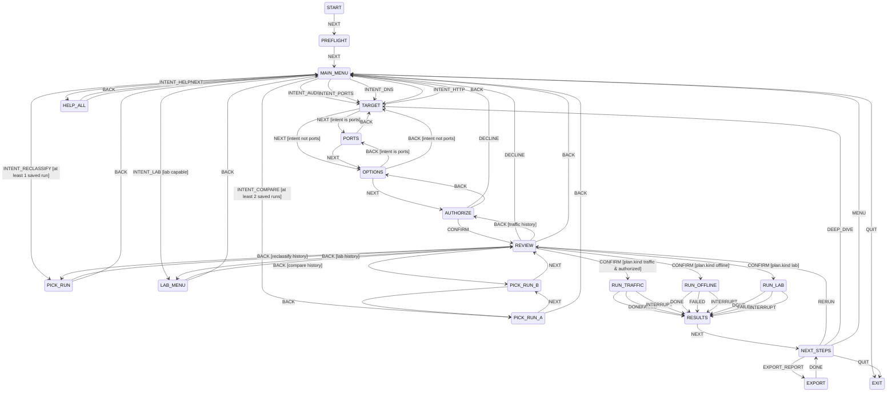

# Netpolicy Interactive Guided Wizard Specification

The `netpolicy` interactive guided wizard provides an intuitive, step-by-step terminal interface that guides users through configuring, authorizing, executing, analyzing, and reporting on network egress policies and middlebox tampering.

---

## 1. Purpose and Architecture

While advanced security engineers frequently invoke CLI subcommands with precise arguments (e.g., `netpolicy audit -t 10.200.2.2 -p 25,80,443 --runs 5`), students, network administrators, and incident responders benefit from a structured decision tree.

The wizard maps user operational intents into deterministic, valid command-line invocations while enforcing safety invariants:

```
[User Goal]
     │
     ▼
[Formal FSM Engine] ──(Immutable WizardContext)──► [Pure Plan Builder]
     │                                                     │
     ▼                                                     ▼
[IO Adapter: Rich / Stderr]                       [Execution Runner: In-Process]
     │                                                     │
     ▼                                                     ▼
[Transcript Logger / Replay]                      [Lab Report Generator]
```

### Key Architectural Tenets
1. **Separation of Presentation and Control**: Wizard chrome renders strictly to `stderr` (`Console(stderr=True)`), ensuring that underlying stdout streams, piped outputs, and JSON payloads remain unpolluted.
2. **Formal State Machine**: Managed via `netpolicy.wizard.fsm`, transitions are mathematically deterministic and fully covered by reachability and invariant proofs.
3. **Strict Input Allow-Lists**: Target hostnames and IP addresses are parsed against RFC specifications, explicitly blocking command injections, shell meta-characters, CIDR ranges, commas, and multicast/broadcast addresses.
4. **Safety Gates**: All active traffic probes require explicit user authorization. Review screens display the exact equivalent CLI command before any execution occurs.
5. **Session Transcripts & Replay**: Interactive sessions record human choices into structured JSON transcripts that can be deterministically replayed in non-interactive CI/CD pipelines.

---

## 2. State Machine Diagram

The wizard is implemented as a finite-state machine with 20 discrete states and 21 events:



---

## 3. State Transition Table

| Source State | Event | Guard Condition | Target State | Description |
|---|---|---|---|---|
| `START` | `NEXT` | None | `PREFLIGHT` | Initializes context, probes host environment and capabilities |
| `PREFLIGHT` | `NEXT` | None | `MAIN_MENU` | Evaluates root privileges, Scapy availability, and saved runs |
| `MAIN_MENU` | `INTENT_AUDIT` | None | `TARGET` | User selects comprehensive policy audit |
| `MAIN_MENU` | `INTENT_PORTS` | None | `TARGET` | User selects specific port reachability audit |
| `MAIN_MENU` | `INTENT_DNS` | None | `TARGET` | User selects DNS tampering and hijacking checks |
| `MAIN_MENU` | `INTENT_HTTP` | None | `TARGET` | User selects HTTP canary and header injection checks |
| `MAIN_MENU` | `INTENT_COMPARE` | Saved runs $\ge 2$ | `PICK_RUN_A` | Compares baseline vs tampered telemetry |
| `MAIN_MENU` | `INTENT_RECLASSIFY`| Saved runs $\ge 1$ | `PICK_RUN` | Re-evaluates raw observations against updated rules |
| `MAIN_MENU` | `INTENT_LAB` | Linux netns capable | `LAB_MENU` | Manages network namespace cyber-range |
| `MAIN_MENU` | `INTENT_HELP_ALL`| None | `HELP_ALL` | Explains all commands and concepts |
| `MAIN_MENU` | `QUIT` | None | `EXIT` | Clean exit from the application |
| `TARGET` | `NEXT` | Intent == "ports" | `PORTS` | Prompts for target port presets or custom port list |
| `TARGET` | `NEXT` | Intent != "ports" | `OPTIONS` | Bypasses port selection for DNS/HTTP/Audit |
| `PORTS` | `NEXT` | Valid port string | `OPTIONS` | Configures runs, timeouts, probe mode, and packet capture |
| `OPTIONS` | `NEXT` | None | `AUTHORIZE` | Transitions to authorization warning screen |
| `AUTHORIZE` | `CONFIRM` | Explicit confirmation | `REVIEW` | User confirms network ownership and authorization |
| `AUTHORIZE` | `DECLINE` | Declined confirmation | `MAIN_MENU` | Declining returns user safely to main menu |
| `PICK_RUN_A` | `NEXT` | Selected Run A | `PICK_RUN_B` | User selects baseline audit run |
| `PICK_RUN_B` | `NEXT` | Selected Run B | `REVIEW` | User selects tampered audit run |
| `PICK_RUN` | `NEXT` | Selected Run | `REVIEW` | User selects telemetry file to reclassify |
| `LAB_MENU` | `NEXT` | Selected Action | `REVIEW` | User selects lab action (status, scenarios, reset) |
| `REVIEW` | `CONFIRM` | Traffic & Authorized | `RUN_TRAFFIC` | Executes active network probe in-process |
| `REVIEW` | `CONFIRM` | Plan Kind == Offline | `RUN_OFFLINE` | Executes compare/reclassify in-process |
| `REVIEW` | `CONFIRM` | Plan Kind == Lab | `RUN_LAB` | Executes lab management command |
| `REVIEW` | `DECLINE` | User selects copy cmd | `MAIN_MENU` | Prints copyable CLI command and returns to menu |
| `RUN_*` | `DONE` / `FAILED`| Execution complete | `RESULTS` | Displays pass/findings summary and verdict banner |
| `RESULTS` | `NEXT` | None | `NEXT_STEPS` | Displays recommended next actions based on findings |
| `NEXT_STEPS` | `EXPORT_REPORT`| User selects export | `EXPORT` | Compiles and writes 12-section academic lab report |
| `NEXT_STEPS` | `RERUN` | User selects re-run | `REVIEW` | Re-executes the planned audit |
| `NEXT_STEPS` | `DEEP_DIVE` | Target recommendation | `TARGET` | Drills down into specific protocol or port range |
| `NEXT_STEPS` | `MENU` | Return to menu | `MAIN_MENU` | Returns to top-level menu |
| `EXPORT` | `DONE` | Report written | `NEXT_STEPS` | Returns to post-audit action menu |
| *Any State* | `QUIT` / `INTERRUPT`| User presses 'q'/Ctrl+C | `EXIT` | Safe immediate shutdown |

---

## 4. Formal Safety Invariants

The FSM guarantees four non-negotiable safety properties verified by unit and invariant test suites:

1. **Authorization Precondition**:
   $$s \in \{\text{RUN\_TRAFFIC}\} \implies \text{ctx.authorized} = \text{True}$$
   No network packets are transmitted unless the user explicitly acknowledges authorization on the `AUTHORIZE` screen.
2. **Review Precondition**:
   $$s \in \{\text{RUN\_TRAFFIC}, \text{RUN\_OFFLINE}, \text{RUN\_LAB}\} \implies \text{REVIEW} \in \text{ctx.history}$$
   No command or probe execution can take place without displaying the exact CLI command on `REVIEW`.
3. **Lab Namespace Isolation**:
   $$s \in \{\text{RUN\_LAB}\} \implies \text{LAB\_MENU} \in \text{ctx.history}$$
   Cyber-range lab interactions can only be invoked through explicit lab menu selection.
4. **Universal Exit and Interrupt Safety**:
   For all non-terminal states $S \setminus \{\text{EXIT}\}$:
   $$\delta(S, \text{QUIT}) = \text{EXIT} \quad \land \quad \delta(S, \text{INTERRUPT}) = \text{EXIT}$$
   Pressing `q` or `Ctrl+C` immediately returns exit code 0 or 130 without leaving orphaned processes.

---

## 5. Input Validation Allow-Lists

User input is sanitized through pure validation functions before entering `WizardContext`:

- **Target Validation (`validate_target`)**:
  - Acceptable: Valid IPv4 (e.g. `10.200.2.2`, `127.0.0.1`) and RFC 1123 hostnames (`probe.example.com`, `localhost`).
  - Rejected: Empty strings, CIDR notation (`10.0.0.0/24`), comma-separated lists, spaces, shell wildcards (`*`, `;`, `&`, `|`), multicast (`224.0.0.0/4`), broadcast (`255.255.255.255`), and unspecified addresses (`0.0.0.0`).
- **Port Specification (`validate_ports`)**:
  - Acceptable: Integer ports between 1 and 65535, separated by commas (max 20 ports).
  - Presets: Standard port groups for Mail (`25,465,587`), SSH (`22`), FTP (`21`), Web (`80,443`), and Common (`PORT_PRESETS["Everything common"]`).
- **Thoroughness & Timeout**:
  - Audit runs: Bounded between 1 and 20 iterations (defaults: Quick=1, Standard=5, Thorough=10).
  - Socket timeout: Clamped between 0.5s and 30.0s.

---

## 6. Telemetry Transcripts and Replay Engine

### Session Transcript Format (`reports/transcript-<run_id>.json`)
Every interactive session records a replayable transcript containing user inputs and state transitions:

```json
{
  "exit_code": 0,
  "inputs": ["1", "10.200.2.2", "4", "2", "y", "1", "q"],
  "steps": [
    {
      "state": "START",
      "event": "NEXT",
      "details": {}
    },
    {
      "state": "MAIN_MENU",
      "event": "INTENT_AUDIT",
      "details": {"intent": "audit"}
    },
    {
      "state": "TARGET",
      "event": "NEXT",
      "details": {"target": "10.200.2.2"}
    },
    {
      "state": "OPTIONS",
      "event": "NEXT",
      "details": {"runs": "5", "mode": "auto"}
    },
    {
      "state": "AUTHORIZE",
      "event": "CONFIRM",
      "details": {"authorized": "True"}
    },
    {
      "state": "REVIEW",
      "event": "CONFIRM",
      "details": {}
    }
  ]
}
```

### Replaying a Session
To execute a previously saved transcript non-interactively:
```bash
netpolicy wizard --replay reports/transcript-20261113_120000.json
```
The session executes deterministically through `ScriptedIO`, asserting identical state transitions and returning the recorded exit code.

---

## 7. Packet Capture & Wireshark Integration

When the user enables packet capture on the `OPTIONS` screen, `PacketCapture` invokes Scapy's `AsyncSniffer`:
- **BPF Filter Generation**: Automatically isolates traffic to the target host and system DNS resolvers:
  ```
  (host 10.200.2.2) or (udp and port 53 and (host 1.1.1.1 or host 8.8.8.8))
  ```
- **PCAP Output**: Saved directly to `reports/capture-<run_id>.pcap`.
- **Integrity Digest**: Computes SHA-256 checksum over the raw PCAP file and embeds it into the audit report.
- **Wireshark Display Filters**: Automatically suggests custom display filters:
  ```
  tcp.flags.reset == 1 and ip.addr == 10.200.2.2
  icmp.type == 3 and ip.addr == 10.200.2.2
  dns.flags.response == 1 and (dns.flags.rcode != 0 or dns.flags.rcode == 3)
  http and ip.addr == 10.200.2.2
  ```

---

## 8. Academic Lab Report Structure

When the user selects **Export Academic Lab Report**, the generator produces a structured Markdown document (`reports/lab-report-<run_id>.md`) adhering to academic standards:

1. **Title & Execution Metadata**: Date, Git commit SHA, Python/OS environment, client IP, network label.
2. **Executive Summary & Verdict Banner**: High-level policy finding (`CLEAN`, `LIMITED`, `ACTION_REQUIRED`, `RESTRICTED`).
3. **Environment & Audit Target Specification**: Operating system details, privilege level, probe driver, BPF filters.
4. **Experimental Methodology & Threat Model**: Explanation of silent packet drops, RST injection, and proxy headers.
5. **Empirical Findings & Observations Table**: Formatted table of detected anomalies, confidence levels, and evidence strings.
6. **Per-Check Latency and Reliability Metrics**: Detailed sample size ($n$), packet loss rate, and RTT statistics (Min, Median, P95, StdDev).
7. **Execution Metrics**: Exact wall-clock elapsed time ($s$), process CPU time ($s$), and peak RSS memory ($KB$).
8. **Network Topography**: ASCII network diagram illustrating client, middlebox gateway, and server endpoints.
9. **Wireshark Packet Analysis**: Suggested Wireshark display filters and packet capture file manifest.
10. **Educational Context & RFC References**: Citations for RFC 9293 (TCP RST), RFC 1035 (DNS), RFC 9110 (HTTP), RFC 5737 (IPv4 Documentation Addresses).
11. **Remediation & Next Steps**: Practical bypass guidance (DoH, VPN, SSH tunnels, port forwarding).
12. **Evidence Manifest & Cryptographic Signatures**: SHA-256 hashes of all input files, telemetry logs, PCAP captures, and generated reports.

---

## 9. Platform Portability & Limitations

- **Windows Native vs. WSL2**:
  - On native Windows, raw TCP SYN packet crafting and packet capture (`AsyncSniffer`) require WinPcap/Npcap drivers and administrative rights. Standard socket mode (`socket`) is recommended and works out of the box.
  - The Linux network namespace lab (`netpolicy lab`, `lab/*.sh`) requires Linux kernels with `CONFIG_NET_NS`. Windows users are prompted to launch via WSL2 (`maybe_launch_wsl`).
- **Interactive TTY Requirement**:
  - The wizard requires interactive standard input and standard error streams (`sys.stdin.isatty() and sys.stderr.isatty()`).
  - In non-interactive environments (cron, CI pipes), bare `netpolicy` falls back to standard `--help`, and `netpolicy wizard` exits with code 2.
- **Escape Hatches**:
  - Pass `--no-wizard` on the command line or set `NETPOLICY_NO_WIZARD=1` to disable the wizard and show standard CLI help.

---

## 10. Conversational Clack Interface & Zero-Touch WSL Handoff

The redesigned wizard delivers a clean, modern terminal user experience inspired by modern developer CLI tools (Clack, `@clack/prompts`):

1. **Left-Rail Design & In-Place Navigation**:
   - Distinctive left-rail markers (`│`, `◆`, `◇`, `✔`, `✖`) with smooth inline `rich.live.Live` updates.
   - Dual navigation: full keyboard arrow navigation (`↑`/`↓`), numeric shortcut keys (`1`-`9`), and question mark (`?`) for inline contextual help.
   - Completed prompts collapse instantly into single-line conversation logs (`✔ Question   Answer`), keeping the screen concise and readable.
   - Graceful fallback: non-TTY environments and legacy terminals seamlessly downgrade to standard prompts and ASCII symbols (`*`, `v`, `x`, `>`).

2. **Plain-English Voice & Central Store**:
   - Strict plain-language rules enforced through a centralized strings repository (`netpolicy/report/humanize.py`).
   - Every sentence is capped at $\le 18$ words, eliminating intimidating jargon (middlebox, canary, TCP RST, ICMP, DNS resolver, egress filtering) from default user-facing prompts.
   - Plain terminology: "websites" for ports 80/443, "address lookups" for DNS, "remote login" for SSH, and "practice network" for the namespace lab.

3. **Zero-Touch WSL Handoff**:
   - Automatically detects native Windows environments and offers a 3-option menu for raw packet auditing inside Kali Linux.
   - **Zero-Touch Execution**: Seamlessly translates project root paths to WSL mount paths using `wslpath`, activates the Linux virtual environment (`.linux-venv/bin/python -m netpolicy`), and passes original user permissions via `SUDO_UID` and `SUDO_GID`.
   - **Seamless Visual Continuity**: Preserves the animated gradient welcome logo in Windows terminal history while setting `NETPOLICY_HANDOFF=1` so Linux immediately renders the Guided Wizard menu without duplicate banners.

4. **Practical Environment-Tailored Solutions**:
   - Replaces theoretical networking advice with ordered, actionable remedies sorted by estimated effort (about 30 seconds, about 5 minutes, a phone call).
   - Generates formatted, copy-pasteable support messages (`reports/support-message-<run_id>.txt`) for campus IT helpdesks, ISPs, and network administrators without technical jargon.
