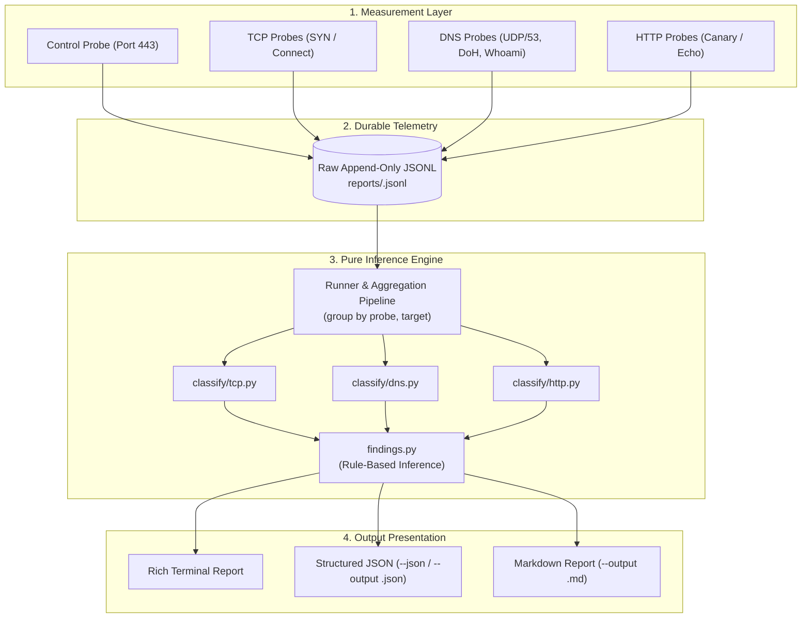

# Netpolicy Master Guide: Network Policy, Interception, and Middlebox Auditing

`netpolicy` is an open-source command-line network policy auditor written in Python 3.10+. It empowers network engineers, students, and developers to uncover what networks—such as campus Wi-Fi, enterprise guest networks, mobile cellular hotspots, and hotel portals—silently block, intercept, or tamper with.

This guide provides a comprehensive pedagogical and operational reference, explaining how middlebox interference works, how `netpolicy` deterministically classifies network policies, how to operate the Linux namespace lab, and how to interpret audit telemetry.

---

## 1. The Problem: Silent Network Tampering

When you connect a laptop or mobile device to a network, you implicitly rely on intermediate networking devices—known as **middleboxes** (firewalls, NAT gateways, deep packet inspection engines, transparent proxies, and captive portals)—to forward your packets faithfully according to Internet standards. 

However, real-world networks frequently enforce intrusive, unannounced egress policies that disrupt developer workflows, break communication protocols, and undermine security:

1. **Silent Firewall Drops (`BLOCKED_DROP`)**:
   - In-path firewalls often silently discard TCP SYN packets targeting specific destination ports (most commonly outbound SMTP port 25 or database ports) without returning any error notification.
   - The sending application hangs until its TCP retransmission timer expires, producing prolonged timeouts without explaining why the connection failed.

2. **Firewall TCP Reset Injection (`BLOCKED_RESET`)**:
   - Middleboxes frequently forge and inject TCP RST (Reset) packets directly into the transport stream, impersonating the destination server to terminate the connection immediately.
   - While this prevents long timeout delays, it presents a deceptive failure signature: the client cannot tell whether the remote server actively refused the connection or a middlebox intercepted and killed the handshake.

3. **ICMP Administrative Rejections (`BLOCKED_ICMP`)**:
   - Security gateways may respond with ICMP Destination Unreachable datagrams, such as Type 3 Code 13 (`Communication Administratively Prohibited`) or Type 3 Code 3 (`Port Unreachable`).
   - Standard application socket APIs often flatten or discard ICMP payloads, masking the exact administrative reason for rejection.

4. **DNS Interception and NXDOMAIN Rewriting (`INTERCEPTED`, `REWRITTEN`)**:
   - **Transparent DNS Redirection**: Middleboxes intercept unencrypted UDP/53 queries destined for public resolvers (such as `8.8.8.8` or `1.1.1.1`) and redirect them to the local gateway or ISP resolver without notifying the client.
   - **NXDOMAIN Hijacking / Rewriting**: When an application queries a nonexistent domain (such as `.invalid`), ISPs and captive portals rewrite the authentic `NXDOMAIN` response into an `A` record pointing to an ISP advertising search engine or captive login portal.

5. **Transparent HTTP Proxies and Header Injection (`HEADERS_INJECTED`, `BODY_MODIFIED`)**:
   - Transparent intermediary HTTP proxies intercept unencrypted port 80 traffic. They inject tracing or caching headers (such as `Via`, `X-Cache`, or `X-Forwarded-For`), alter payload bodies, or strip client validation nonces.

### Why `ping` and Speed Tests Do Not Reveal Them
A network can appear fully functional while silently sabotaging critical developer tools:
- **`ping` (ICMP Echo)** tests only network-layer reachability to a specific host (often a nearby gateway or DNS resolver). It carries no transport-layer port context and cannot reveal if TCP ports 25, 22, or 587 are blocked.
- **Speed tests** (such as Ookla Speedtest or Fast.com) measure raw bandwidth across established HTTP/HTTPS connections on ports 80/443 to optimized CDN edge nodes. They never test outbound mail submission, custom developer ports, DNS rewriting, or proxy header tampering.

### Who Is Affected?
- **Computer Science & Engineering Students**: Campus Wi-Fi networks routinely block non-standard ports, terminate SSH sessions on port 22, block SMTP submission on ports 25 and 587, and intercept DNS lookups.
- **Software Developers**: Engineers working remotely or on corporate guest Wi-Fi frequently find that Git over SSH fails, webhook testing breaks due to injected proxy headers, or direct database connections on custom ports time out silently.
- **Travellers & Remote Workers**: Hotel, airport, and cafe networks operate aggressive captive portals that redirect unencrypted DNS queries and hijack HTTP requests, breaking VPN tunnels and API clients.

---

## 2. How It Works: Architecture, Lab, and Classifiers

### 2.1 System Architecture & Data Flow

`netpolicy` is structured around a strict separation of measurement (probes) and inference (classifiers). Probes collect raw network measurements without making assumptions; classifiers evaluate measurements offline through pure, stateless logic.



#### Key Architectural Components
1. **The Control Probe**:
   - Before diagnosing any target port as blocked, `netpolicy` executes a control probe against a known open port on the target server (default: port 443).
   - If the control probe fails, the entire destination host or local network path is deemed unreachable. The system issues a `CONTROL_FAILED` verdict, preventing transient internet outages from being misdiagnosed as intentional firewall blocking.
2. **Retries and Multi-Run Sampling**:
   - To differentiate transient network loss from deterministic firewall policy, each check runs for $N$ iterations (default: 5 runs, configurable with `--runs`) with multiple retries per probe (default: 2 retries, configurable with `--retries`).
   - A port is declared `BLOCKED_DROP` only when all retries fail across iterations while the control probe succeeds.
3. **Durable Raw Telemetry (`.jsonl`) Before Classification**:
   - Every raw observation is flushed immediately to an append-only file under `reports/<run_id>.jsonl`.
   - If a scan is aborted (e.g. via `Ctrl-C`), zero telemetry is lost. The collected data can be analyzed offline or reclassified later.

---

### 2.2 The Controlled Lab Topology

To rigorously validate probes and classifiers against known ground-truth middlebox policies without affecting host network settings, `netpolicy` includes an automated 3-node testbed built with Linux network namespaces (`np-client`, `np-gw`, `np-server`).

```text
+-------------------------------------------------------------------------------------------------+
|                                    NETPOLICY TEST LAB TOPOLOGY                                  |
+-------------------------------------------------------------------------------------------------+

 [ np-client Namespace ]                 [ np-gw Namespace ]                 [ np-server Namespace ]
 (Audit Origin Node)                     (Middlebox Router)                  (Mock Services Node)

   10.200.1.2/24                           10.200.1.1/24                       10.200.2.2/24
 +---------------+                       +---------------+                   +---------------+
 |  veth-client  | <=== veth pair 1 ===> |   veth-gw-c   |                   |  veth-server  |
 +---------------+                       +---------------+                   +---------------+
         |                                       |                                   ^
         | Default Route                         | IPv4 Forwarding = 1               | veth pair 2
         v                                       | Blackholes: 192.0.2.0/24          |
   via 10.200.1.1                                |             198.51.100.0/24       v
                                                 |                            +---------------+
                                                 | 10.200.2.1/24              |   veth-gw-s   |
                                                 +--------------------------> +---------------+
                                                                                     |
                                                                                     | Default Route
                                                                                     v
                                                                               via 10.200.2.1

  Subnet 1: 10.200.1.0/24 (Client Subnet)                      Subnet 2: 10.200.2.0/24 (Server Subnet)
```

#### Why Network Namespaces Guarantee Zero Host Pollution
- **Isolated Kernel Subsystems**: Each Linux network namespace maintains its own independent network interfaces, IP routing tables, `iptables`/`nftables` rules, ARP caches, and socket listening tables.
- **Direct Veth Creation**: Both ends of each virtual Ethernet (`veth`) link are placed directly into their target namespaces upon creation (`ip link add A netns np-x type veth peer name B netns np-y`). Neither endpoint ever enters or touches the host root namespace.
- **Forwarding Confined to `np-gw`**: Kernel packet forwarding (`net.ipv4.ip_forward=1`) is enabled exclusively within `np-gw`. Forwarding in the host namespace remains disabled.
- **Isolated DNS Resolution**: DNS settings are written to per-namespace files (`/etc/netns/np-<name>/resolv.conf`). Host `/etc/resolv.conf` is never touched.
- **No Internet Uplink**: The lab has no NAT connection or bridge to host physical adapters, eliminating any risk of leaking test traffic to the internet.

---

### 2.3 Classification Rules Reference

Classifiers are pure mathematical functions: $\text{Observations} \to \text{Verdict}(\text{Kind}, \text{Confidence}, \text{Evidence})$.

| Domain | Verdict Kind | Evidence / Decision Criteria | Confidence | Caveats & Technical Nuances |
|---|---|---|---|---|
| **Port** | `OPEN` | SYN-ACK packet received (raw mode) or successful TCP `connect()` (socket mode). | **HIGH** | Connection established successfully. |
| **Port** | `BLOCKED_DROP` | All retries timed out (0 replies received) while target control port (443) remained healthy. | **HIGH** | Requires verified control probe to separate firewall drop from general link failure. |
| **Port** | `BLOCKED_RESET` | TCP RST packet received and RST TTL differs from control port SYN-ACK TTL by $> 2$ (with `expect_open=True`). | **HIGH** | TTL delta $> 2$ indicates RST was synthesized by an in-path middlebox, not destination host. |
| **Port** | `BLOCKED_ICMP` | Received ICMP Destination Unreachable datagram (Type 3 Code 13 Admin Prohibited, Code 3 Port Unreachable, etc.). | **HIGH** | Contains explicit ICMP type/code returned by middlebox gateway. |
| **Port** | `CLOSED_OR_RESET`| TCP RST packet received when destination port was not known to be open (`expect_open=False`). | **LOW** | **Ambiguity Caveat**: Without ground-truth server knowledge, an RST can mean either a closed port or an in-path firewall reset. |
| **Port** | `LOSSY` | Mixed successes and timeouts, but control port remains responsive across probe iterations. | **MEDIUM** | Indicates transport-layer packet loss or rate-limiting on specific port. |
| **Port** | `CONTROL_FAILED`| Control probe to known open port failed or timed out. | **HIGH** | Network path is broken; individual port block conclusions are suppressed. |
| **DNS** | `CLEAN` | Authentic query response received; query for `.invalid` domain returns NXDOMAIN; source IP matches queried IP. | **HIGH** | Standard DNS resolution behavior verified. |
| **DNS** | `INTERCEPTED` | Reply received for RFC 5737 documentation blackhole addresses, or response source IP differs from queried IP, or `whoami` resolver IP is outside expected subnet. | **HIGH** | Proves transparent redirection of UDP/53 queries. |
| **DNS** | `REWRITTEN` | Query for nonexistent `.invalid` domain returned an `A` record instead of `NXDOMAIN`. | **HIGH** | Proves NXDOMAIN hijacking (e.g. ISP search portal redirection). |
| **DNS** | `MISMATCH` | Unencrypted UDP/53 answer set does not overlap with encrypted DNS-over-HTTPS (DoH) answer set. | **MEDIUM / LOW** | **CDN Geo-Variation Caveat**: CDN Anycast IP pools vary across geographical locations; used as supporting evidence only. |
| **HTTP** | `CLEAN` | Status 200 received; payload SHA-256 matches manifest; no injected proxy headers; request nonce echoed intact. | **HIGH** | Content and transport stream unaltered. |
| **HTTP** | `HEADERS_INJECTED`| Upstream response contains proxy headers (`Via`, `X-Cache`, `X-Forwarded-For`). | **HIGH** | Proves an intermediary HTTP proxy inspected and modified the stream. |
| **HTTP** | `BODY_MODIFIED` | HTTP status 200 received, but payload body SHA-256 differs from expected manifest hash. | **HIGH** | Proves in-transit content modification or HTML injection. |
| **HTTP** | `PROXIED` | Echoed `X-NetPolicy-Nonce` token was stripped, altered, or replaced by intermediary. | **HIGH** | Indicates proxy connection rewrite. |
| **HTTP** | `REDIRECTED` | Status code 301, 302, 307, or 308 received redirecting client to captive portal login page. | **HIGH** | Proves captive portal interception. |

---

### 2.4 Ground-Truth Scenario Catalogue

Defined in [`lab/scenarios.yaml`](../lab/scenarios.yaml) and applied via [`lab/scenario.sh`](../lab/scenario.sh):

| Scenario Name | Exact Firewall Rule / Mechanism Applied | Target NS | Expected Port Verdict | Expected DNS Verdict | Expected HTTP Verdict |
|---|---|---|---|---|---|
| `clean` | All iptables rules flushed; policy `FORWARD ACCEPT` | `np-gw` | Ports 21, 22, 25, 443, 587 `OPEN` | `CLEAN` | `CLEAN` |
| `drop-smtp` | `iptables -A FORWARD -p tcp --dport 25 -j DROP` | `np-gw` | Port 25 `BLOCKED_DROP`; others `OPEN` | `CLEAN` | `CLEAN` |
| `reset-smtp` | `iptables -A FORWARD -p tcp --dport 25 -j REJECT --reject-with tcp-reset` | `np-gw` | Port 25 `BLOCKED_RESET`; others `OPEN` | `CLEAN` | `CLEAN` |
| `icmp-admin` | `iptables -A FORWARD -p tcp --dport 25 -j REJECT --reject-with icmp-admin-prohibited` | `np-gw` | Port 25 `BLOCKED_ICMP` (code 13); others `OPEN`| `CLEAN` | `CLEAN` |
| `icmp-port-unreach` | `iptables -A FORWARD -p tcp --dport 25 -j REJECT --reject-with icmp-port-unreachable` | `np-gw` | Port 25 `BLOCKED_ICMP` (code 3); others `OPEN` | `CLEAN` | `CLEAN` |
| `dns-dnat` | `iptables -t nat -A PREROUTING -p udp --dport 53 -j DNAT --to-destination 10.200.1.1:53` | `np-gw` | Ports `OPEN` | `INTERCEPTED` | `CLEAN` |
| `nxdomain-rewrite` | DNS server in `np-server` restarted with `--rewrite` flag | `np-server` | Ports `OPEN` | `REWRITTEN` | `CLEAN` |
| `http-proxy` | Tamper proxy on port 8080; `iptables -t nat -A PREROUTING -p tcp --dport 80 -j DNAT --to-destination 10.200.1.1:8080` | `np-gw` | Ports `OPEN` | `CLEAN` | `HEADERS_INJECTED` |
| `campus` | Composite: applies `reset-smtp` + `dns-dnat` + `http-proxy` | `np-gw` | Port 25 `BLOCKED_RESET`; others `OPEN` | `INTERCEPTED` | `HEADERS_INJECTED` |

---

## 3. Operation Manual: Step-by-Step Workflow

Follow these numbered steps to run a complete demonstration, audit, comparison, and validation workflow.

### Step 1: System and Environment Prerequisites

Install system dependencies and configure the Python virtual environment.

```bash
# 1. Install OS packages (Debian/Ubuntu/Kali - requires root) (root)
sudo bash scripts/bootstrap-system.sh
```
- **Privilege**: Root (`sudo`).
- **Expected Output**: Package installation confirmations (`python3`, `iproute2`, `iptables`, `curl`, `iputils-ping`, etc.).
- **Exit Code**: `0`.

```bash
# 2. Bootstrap virtual environment and install netpolicy (run as regular user)
bash scripts/bootstrap-python.sh
```
- **Privilege**: Regular unprivileged user (refuses root).
- **Expected Output**: Creates `.linux-venv`, bootstraps pip with `get-pip.py`, and installs `netpolicy` with `.[lab]`.
- **Exit Code**: `0`.

```bash
# 3. Verify environment health and tooling diagnostics
bash scripts/doctor.sh
```
- **Privilege**: Regular user (or `sudo bash scripts/doctor.sh` for optional throwaway namespace self-tests).
- **Expected Output**: Formatted diagnostic checks showing `[PASS]` for OS, Python $\ge 3.10$, virtualenv health, and tools.
- **Exit Code**: `0`.

---

### Step 2: Lab Provisioning and Services Startup

Provision the 3-node namespace topology and start mock target services inside `np-server`.

```bash
# 1. Create network namespaces and veth topology (root)
sudo bash lab/setup.sh
```
- **Privilege**: Root.
- **Expected Output**: Creation of `np-client`, `np-gw`, `np-server`, IP address assignment, blackholes, and `[OK] Ping verification passed`.
- **Exit Code**: `0`.

```bash
# 2. Start mock services detached inside np-server (root)
sudo bash lab/services.sh start
```
- **Privilege**: Root.
- **Expected Output**: Formatted summary table listing `banner_listeners` (ports 21, 22, 25, 443, 587), `canary_server` (port 80), and `dns_server` (port 53) along with process PIDs.
- **Exit Code**: `0`.

```bash
# 3. Inspect live operational status (root)
sudo bash lab/status.sh
```
- **Privilege**: Root.
- **Expected Output**: Read-only display of active namespaces, IP addresses, firewall rules, and listening sockets.
- **Exit Code**: `0`.

---

### Step 3: Run Baseline Audit (Clean Network)

Execute a baseline audit from `np-client` against target server `10.200.2.2` before applying any middlebox restrictions, saving the classified result to JSON.

```bash
# Run baseline audit from np-client (root)
sudo ip netns exec np-client .linux-venv/bin/python -m netpolicy audit --target 10.200.2.2 --ports 21,22,25,80,443,587 --runs 2 --no-color --output demo-output/baseline.json
```
- **Privilege**: Root (to execute inside `np-client`).
- **Expected Output**: Terminal summary table confirming all audited ports are `OPEN`, DNS is `CLEAN`, and HTTP is `CLEAN`.
- **Exit Code**: `0` (clean network, zero findings).

#### Targeted Subsystem Audits (Optional)
You can also audit individual network subsystems independently:

```bash
# 1. Audit outbound ports only (root)
sudo ip netns exec np-client .linux-venv/bin/python -m netpolicy ports --target 10.200.2.2 --ports 21,22,25,80,443,587 --runs 2 --no-color

# 2. Audit DNS resolution integrity only (root)
sudo ip netns exec np-client .linux-venv/bin/python -m netpolicy dns --target 10.200.2.2 --runs 2 --no-color

# 3. Audit HTTP canary tampering only (root)
sudo ip netns exec np-client .linux-venv/bin/python -m netpolicy http --target 10.200.2.2 --ports 80 --runs 2 --no-color
```
- **Privilege**: Root.
- **Expected Output**: Domain-specific terminal reports for ports, DNS, or HTTP.
- **Exit Code**: `0` (clean).


---

### Step 4: Apply a Middlebox Scenario

> [!IMPORTANT]
> **Scenarios are strictly exclusive**: Every call to `lab/scenario.sh` first flushes all firewall rules in `np-gw`, stops any active proxies, and restores the DNS server before applying the selected scenario. Scenarios never stack. To test multiple policies simultaneously, use composite scenarios like `campus`.

Apply the `reset-smtp` scenario:

```bash
# Inject TCP RST packets on outbound SMTP port 25 (root)
sudo bash lab/scenario.sh reset-smtp
```
- **Privilege**: Root.
- **Expected Output**: Displays `SCENARIO APPLIED: reset-smtp`, target namespace `np-gw`, rule `iptables -A FORWARD -p tcp --dport 25 -j REJECT --reject-with tcp-reset`, and host safety verification.
- **Exit Code**: `0`.

---

### Step 5: Run Tampered Audit

Execute a second audit from `np-client` to detect the newly introduced middlebox restriction.

```bash
# Run tampered audit from np-client (root)
sudo ip netns exec np-client .linux-venv/bin/python -m netpolicy audit --target 10.200.2.2 --ports 21,22,25,80,443,587 --runs 2 --no-color --output demo-output/tampered.json
```
- **Privilege**: Root.
- **Expected Output**: Terminal report highlighting port 25 as `BLOCKED_RESET` (Evidence: `TCP RST`), accompanied by a critical severity finding: `Outbound Email Submission Blocked`.
- **Exit Code**: `1` (policy findings detected).

---

### Step 6: Compare Baseline and Tampered Reports

Diff the baseline and tampered reports to identify policy changes.

```bash
# Compare baseline and tampered audit reports
.linux-venv/bin/python -m netpolicy compare demo-output/baseline.json demo-output/tampered.json
```
- **Privilege**: Regular user.
- **Expected Output**: Formatted table showing changes:
  - Port 25: `OPEN` $\to$ `BLOCKED_RESET` (Confidence: `HIGH`).
  - New finding: `[critical] SMTP_BLOCKED: Outbound Email Submission Blocked`.
- **Exit Code**: `1` (differences detected between reports; exits `0` if identical).

---

### Step 7: Reclassify Raw Telemetry Offline

Reclassify raw observation data from a previous run using updated rules without generating network traffic:

```bash
# Reclassify saved raw observation JSONL file
.linux-venv/bin/python -m netpolicy reclassify demo-output/tampered.json
```
*(Note: Can also pass a run ID or path to a `.jsonl` file stored under `reports/`)*.
- **Privilege**: Regular user.
- **Expected Output**: Re-rendered terminal report with re-evaluated verdicts and findings.
- **Exit Code**: `1` (if findings present) or `0` (if clean).

---

### Step 8: Run Ground-Truth Validation Framework

The validation harness ([`lab/validate.py`](../lab/validate.py)) runs automated statistical testing across all scenarios in `scenarios.yaml`.

#### Quick Validation Run (5 runs per scenario)
```bash
# Quick validation run (root)
sudo .linux-venv/bin/python lab/validate.py --runs 5
```

#### Full Validation Run with Network Impairment Sweeps (30 runs + `tc netem`)
```bash
# Comprehensive validation with loss & latency sweeps (root)
sudo .linux-venv/bin/python lab/validate.py --runs 30 --netem
```
- **Privilege**: Root.
- **Artifacts Produced** (in `results/`):
  - `results/validation.csv`: Complete raw check evaluation dataset.
  - `results/confusion_matrix.png`: Heatmap plot of classifier confusion matrices.
  - `results/accuracy.png`: Bar chart of classification accuracy per scenario with error bars.
  - `results/netem_degradation.png`: Degradation curves under packet loss ($0\text{--}10\%$) and latency ($10\text{--}200\text{ ms}$).
- **How to Read the Confusion Matrix**:
  - The rows represent the actual ground-truth condition applied by `scenario.sh`.
  - The columns represent the classifier's predicted verdict.
  - A perfect classifier is strictly diagonal. Non-diagonal entries indicate misclassifications.
- **False-Positive Rate (FPR)**:
  - Evaluated on the `clean` scenario.
  - For validation to pass, the clean false-positive rate must be exactly `0.0%` and clean accuracy must be $\ge 95\%$.
- **Validation Results**:
  - Empirical validation data: **TBD: run validate.py** (Run `sudo .linux-venv/bin/python lab/validate.py --runs 30` to generate `results/validation.csv`).
- **Exit Code**: `0` on success; `1` on failure (FPR $> 0$ or accuracy below threshold).

---

### Step 9: Lab Teardown

Tear down the lab topology and clean up background services.

```bash
# Clean up lab namespaces and processes (root)
sudo bash lab/teardown.sh
```
- **Privilege**: Root.
- **Expected Output**: Terminates background services, removes `np-client`, `np-gw`, `np-server`, and deletes `/etc/netns/np-*`.
- **Exit Code**: `0`.

---

### Step 10: Export Documentation to Windows Host (Optional)

When developing or auditing inside a WSL2 environment, you can export the master guide and portability report directly to your Windows host's `Downloads\netpolicy` folder without root privileges:

```bash
# Export docs to Windows Downloads\netpolicy (unprivileged user)
bash scripts/export-docs.sh
```
- **Privilege**: Regular unprivileged user (requires no root, invokes no `sudo`).
- **Destination**: Dynamically resolves your Windows user profile via `wslpath "$(cmd.exe /c 'echo %USERPROFILE%' 2>/dev/null | tr -d '\r')"` to `<Windows-User>\Downloads\netpolicy\`.
- **Backup Protection**: Never silently overwrites files. If a file already exists at the destination, it is moved to a timestamped backup (`.bak.<timestamp>`) and the backup path is printed to the terminal.
- **Custom Destination**: You can optionally pass a custom directory argument:
  ```bash
  bash scripts/export-docs.sh /path/to/custom/destination
  ```
- **Non-WSL Fallback**: If executed on native Linux or if `cmd.exe` interop is disabled, the script prints local Linux paths and Windows UNC access paths (`\\wsl$\<distro>\...`) with manual copy instructions.
- **Exit Code**: `0`.

---

## 4. Interpreting Results and Limitations

While `netpolicy` provides deterministic, high-confidence network policy detection, users should understand its design assumptions and boundaries:

1. **Emulated vs. Commercial Middleboxes**:
   - The lab validates classifiers against software Linux network implementations (`iptables`, `nftables`, Python proxies).
   - Enterprise hardware middleboxes (such as Palo Alto Networks, Fortinet, Check Point, or Cisco ASA appliances) perform deep packet inspection, stateful TCP window reassembly, and active Layer 7 protocol validation. Real-world middleboxes may behave differently from standard iptables targets.

2. **Heuristics Are Not Absolute Certainty**:
   - Differentiating an intentional silent packet drop (`BLOCKED_DROP`) from transient congestion requires relying on the health of the target control port (443). If the network path suffers severe general packet loss, conclusions are marked `LOSSY` rather than definitive blocks.
   - A TCP RST received on a port that you do not own or control is fundamentally ambiguous (`CLOSED_OR_RESET` with `LOW` confidence): without ground truth, it is impossible to prove whether the destination port was closed or an intermediary reset the connection.

3. **WSL2 NAT Boundary Effects**:
   - Windows Subsystem for Linux (WSL2) runs within a Hyper-V lightweight utility VM behind a virtual NAT switch.
   - When running real-world audits against internet targets from WSL2, the Windows host networking stack and Windows Defender Firewall may intercept, rewrite, or reset raw TCP SYN packets before they reach the physical network adapter.
   - For authoritative raw socket audits, run `netpolicy` on native Linux.

---

## 5. Ethics and Legal Notice

> [!IMPORTANT]
> **Authorization Requirement**: You must only audit networks, gateways, and destination servers that you own or have explicit written permission to test.

- **No Range Scanning**: `netpolicy` is strictly a network policy auditor, not a port scanner. It audits only specific, user-designated destination ports and endpoints. It does not perform subnet sweeps or broad port ranges.
- **Privacy by Default**: Telemetry scrubs client public IP addresses, MAC addresses, and network SSIDs by default. Cryptographic SHA-256 network fingerprints (`fp:...`) are generated from gateway and resolver addresses for correlation without leaking identifying network identifiers.
- **Passive Safety**: Running `netpolicy` audits in unprivileged mode (`--mode socket`) alters zero host network settings.

---

## 6. Troubleshooting

For detailed operating system compatibility, WSL2 workarounds, and package manager fixes, consult [`docs/PORTABILITY.md`](PORTABILITY.md).

| Symptom / Error | Root Cause | Resolution |
|---|---|---|
| `ModuleNotFoundError: No module named 'pip._internal.utils'` | Upstream Debian/Kali Linux `python3-venv` bug. | Run `bash scripts/bootstrap-python.sh` (bootstraps pip via `get-pip.py`). |
| `Missing lab dependencies. Run: python -m pip install -e ".[lab]"` | Missing `matplotlib`, `pandas`, `yaml`, or `rich`. | Run `.linux-venv/bin/python -m pip install -e ".[lab]"`. |
| `ERROR: lab/setup.sh must be run with root privileges (EUID 0)` | Lab scripts require root to configure namespaces. | Prefix script execution with `sudo` (e.g. `sudo bash lab/setup.sh`). |
| `Error: Could not find audit run file '...'` | `.jsonl` run file not found in current directory or `./reports/`. | Verify file exists under `./reports/` or provide absolute path. |
| Port 25 classified as `CLOSED_OR_RESET` instead of `BLOCKED_RESET` | Target server port not known to be open (`expect_open=False`). | Run against controlled lab target `10.200.2.2` where mock listener is active. |

---

## 7. Glossary

- **Canary Server**: A dedicated control HTTP server serving known, immutable content hashes and expected headers used to verify stream integrity.
- **Confusion Matrix**: A contingency table where rows represent true ground-truth policies and columns represent classifier predictions, used to evaluate model accuracy.
- **Control Probe**: A baseline probe to a known open port (default 443) used to confirm destination reachability before classifying other ports as blocked.
- **DNS Interception**: Transparent redirection of UDP/53 datagrams by middleboxes to a resolver different from the one requested.
- **DNS-over-HTTPS (DoH)**: Encrypted DNS queries transmitted over HTTPS/TLS, preventing in-path middlebox inspection and tampering.
- **False-Positive Rate (FPR)**: The ratio of unblocked checks falsely classified as blocked, required to be strictly `0.0%` on clean networks.
- **Middlebox**: Any intermediary networking device in a data path that inspects, modifies, filters, or terminates traffic other than standard IP routing.
- **Network Fingerprint (`fp:...`)**: A privacy-preserving SHA-256 hash derived from the default gateway IP and primary DNS resolver IP.
- **Network Namespace (`netns`)**: A Linux kernel virtualization feature providing an isolated instance of the network stack.
- **NXDOMAIN Rewriting**: Middlebox or ISP tampering that replaces authentic `NXDOMAIN` (nonexistent domain) responses with IP addresses for search portals or captive portals.
- **Silent Drop**: A firewall policy that discards packets without sending an ICMP error message or TCP RST packet back to the sender.
- **TCP RST (Reset)**: A TCP control flag indicating that the connection was abruptly refused or terminated.
- **Traffic Control (`tc netem`)**: The Linux kernel network emulation subsystem used to inject synthetic packet loss, delay, and jitter.
- **Transparent Proxy**: An intermediary proxy that intercepts network connections at the transport layer without requiring client configuration.
- **Virtual Ethernet (`veth`)**: A Linux virtual networking device created in interconnected pairs acting as a bidirectional virtual wire between namespaces.
