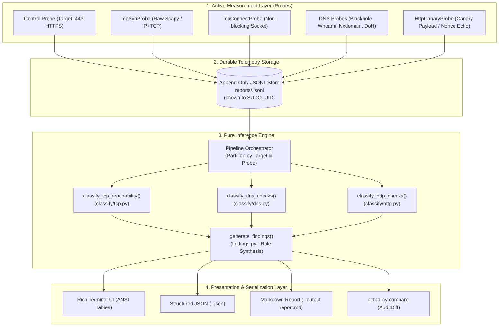

# Netpolicy: Deterministic Detection and Analysis of Silent Middlebox Tampering in Heterogeneous Network Environments

**A Comprehensive Technical Report and Academic Study Guide**

**Project Name:** `netpolicy`  
**Version:** `0.1.0`  
**Author:** Tanishq Rana  
**Repository Source:** [netpolicy](file:///C:/Users/tanis/Downloads/netpolicy)  
**Academic Target:** Computer Science & Network Engineering Review  
**Date:** November 2026  

---

## Executive Summary & Abstract

Modern computer networks increasingly rely on intermediate network entities—collectively termed **middleboxes**—to enforce security policies, manage traffic demand, and optimize bandwidth utilization. In enterprise campuses, residential Internet Service Providers (ISPs), mobile cellular hotspots, and public hospitality networks, middleboxes routinely deviate from standard end-to-end transport semantics. Rather than faithfully forwarding packets, these entities silently discard transport datagrams, forge and inject TCP Reset (`RST`) flags, return ICMP administrative rejections, intercept and redirect unencrypted DNS queries, hijack nonexistent domain (`NXDOMAIN`) responses, and inject transparent proxy headers into cleartext HTTP streams. 

Standard network diagnostic utilities, such as ICMP Echo (`ping`), `traceroute`, and speed test engines, operate at abstraction layers that fail to expose these transport- and application-layer manipulations. When a developer encounters an unannounced transport failure—such as a blocked outbound SSH port or an intercepted DNS lookup—standard tooling leaves the engineer incapable of differentiating between transient upstream packet loss, remote service outages, and active network policy enforcement.

This report presents **`netpolicy`**, an open-source, deterministic command-line auditing system and reproducible experimental framework written in Python 3.10+. `netpolicy` isolates network interference through structured active probes, persistent raw telemetry storage, and pure, stateless classification functions. To validate detection accuracy without contaminating host networking or violating ethical boundaries, the project incorporates an automated, isolated 3-node cyber-range testbed implemented via Linux network namespaces (`np-client`, `np-gw`, `np-server`) interconnected through virtual Ethernet (`veth`) pairs. The report provides an exhaustive analysis of the system architecture, probing methodologies, classification decision tables, cyber-range engineering, cross-platform portability challenges between Windows WSL2 and native Linux, and theoretical detection boundaries.

---

## Table of Contents

1. [The Problem Statement: Silent Network Tampering](#1-the-problem-statement-silent-network-tampering)
   - 1.1 The Middlebox Dilemma and the Violation of the End-to-End Principle
   - 1.2 Taxonomy of Silent Network Interference
   - 1.3 Inadequacy of Classical Diagnostic Tools
   - 1.4 Target Demographics and Operational Impact
2. [System Architecture and Design Principles](#2-system-architecture-and-design-principles)
   - 2.1 Core Architectural Pillars
   - 2.2 System Data Flow & Pipeline
   - 2.3 Probing Subsystem (Measurement Layer)
   - 2.4 Durable Telemetry (Append-Only JSONL Store)
   - 2.5 Pure Classification & Inference Engine
   - 2.6 The Baseline Control Probe Mechanism
   - 2.7 Multithreaded Concurrency & Rate-Limiting Engine
3. [Cyber-Range Testbed: Linux Network Namespaces](#3-cyber-range-testbed-linux-network-namespaces)
   - 3.1 Architectural Motivation for Namespaces
   - 3.2 3-Node Topology and Virtual Ethernet Infrastructure
   - 3.3 Addressing, Routing, and Blackhole Engineering
   - 3.4 Non-Negotiable Host Isolation and Safety Guarantees
   - 3.5 Detached Target Services Lifecycle Management
4. [Experimental Methodology and Scenario Validation](#4-experimental-methodology-and-scenario-validation)
   - 4.1 Ground-Truth Scenario Catalogue
   - 4.2 Scenario Exclusivity and Deterministic State Flushing
   - 4.3 Automated Statistical Validation Harness (`validate.py`)
   - 4.4 Network Emulation under Loss and Latency Degradation (`tc netem`)
   - 4.5 Empirical Field Testing Methodology (Phase 2 Audits)
5. [Development Journey and Portability Engineering](#5-development-journey-and-portability-engineering)
   - 5.1 The WSL2 vs. Windows Host Virtualization Boundary
   - 5.2 Empirical Defects Identified in Testing and Implemented Solutions
   - 5.3 Proactive Protections Against Environmental Failures
   - 5.4 Diagnostic and Automated Automation Suite
6. [Comprehensive Technology Stack](#6-comprehensive-technology-stack)
7. [Inherent Limitations and Theoretical Boundaries](#7-inherent-limitations-and-theoretical-boundaries)
   - 7.1 The Ambiguity of TCP RSTs on Uncontrolled Endpoints
   - 7.2 WSL2 Hyper-V NAT Switch Artifacts
   - 7.3 Content Delivery Network (CDN) Anycast Incoherence
   - 7.4 Heuristics vs. Absolute Determinism
   - 7.5 Synthetic Linux Software Stacks vs. Commercial Hardware Middleboxes
8. [Conclusion and Academic Contributions](#8-conclusion-and-academic-contributions)
9. [References and Repository Navigation](#9-references-and-repository-navigation)

---

## 1. The Problem Statement: Silent Network Tampering

### 1.1 The Middlebox Dilemma and the Violation of the End-to-End Principle

The architectural foundation of the Internet, formulated by Saltzer, Reed, and Clark in their seminal 1984 paper, is the **End-to-End Principle**. This design axiom dictates that network reliability, protocol state maintenance, and security checks must reside primarily at the communicating communication endpoints, while the intermediary transit path remains a stateless, packet-forwarding datagram substrate.

In contemporary network engineering, this principle is widely violated by middleboxes. A middlebox is defined in RFC 3234 as any intermediary device performing functions other than the standard IP routing of datagrams. Middleboxes encompass stateful packet inspection (SPI) firewalls, Carrier-Grade NAT (CGNAT) gateways, transparent web proxies, deep packet inspection (DPI) appliances, content filtering devices, and captive portal controllers. While deployed for traffic optimization, regulatory compliance, and perimeter security, middleboxes frequently enforce aggressive, opaque egress policies without signaling their presence or actions to client devices.

```
+---------------+                                                      +---------------+
|               |  [SYN] Dest: Port 25                                  |               |
| Client Host   | -------------------------\                           | Remote Target |
| (np-client)   |                          |                           | (np-server)   |
|               |  [Injected RST] TTL=64   |                           |               |
|               | <------------------------+                           |               |
+---------------+                          |                           +---------------+
                                           |
                                   +-------v-------+
                                   |   Middlebox   |  Drops SYN / Forges RST
                                   |    Gateway    |  (Never forwards to server)
                                   |    (np-gw)    |
                                   +---------------+
```

### 1.2 Taxonomy of Silent Network Interference

Middlebox tampering manifests across multiple protocol layers. `netpolicy` categorizes these phenomena into five primary failure modes:

1. **Silent Firewall Drops (`BLOCKED_DROP`)**:
   - In-path firewalls configured with `-j DROP` discard transport datagrams (e.g., TCP SYN packets targeting TCP port 25 or database ports) without returning any feedback.
   - The sending operating system continues TCP exponential backoff retransmissions ($1\text{ s}, 2\text{ s}, 4\text{ s}, \dots$) until the socket connect timeout expires (typically 30–120 seconds). The end-user application receives a generic timeout error (`ETIMEDOUT`), masking whether the drop occurred at the local gateway, the ISP transit link, or the target host.

2. **Firewall TCP Reset Injection (`BLOCKED_RESET`)**:
   - Rather than dropping packets silently, intermediary devices frequently forge and inject TCP `RST` (Reset) packets directly into the transport path.
   - The middlebox fabricates an IP packet using the destination server's IP address as the source, sets the TCP `RST` or `RST-ACK` flag matching the client's sequence number, and terminates the socket connection instantly (`ECONNREFUSED`).
   - This creates an acute diagnostic ambiguity: the client cannot tell whether the target server actively refused the connection because no listening daemon exists, or an intermediate firewall forged the reset packet.

3. **ICMP Administrative Rejections (`BLOCKED_ICMP`)**:
   - Intermediary routers and security appliances often reject filtered traffic by emitting ICMP Destination Unreachable datagrams (RFC 792, RFC 1812).
   - Prominent codes include Type 3 Code 9 (*Destination Network Administratively Prohibited*), Type 3 Code 10 (*Destination Host Administratively Prohibited*), and Type 3 Code 13 (*Communication Administratively Prohibited*).
   - Standard operating system socket APIs frequently collapse these rich ICMP error datagrams into generic connection refusal or unreachable errors, stripping the specific administrative code from developer visibility.

4. **DNS Interception and NXDOMAIN Rewriting (`INTERCEPTED`, `REWRITTEN`)**:
   - **Transparent DNS Redirection**: Middleboxes capture cleartext UDP/53 datagrams directed toward trusted public resolvers (e.g., Google DNS `8.8.8.8`, Cloudflare `1.1.1.1`) and transparently reroute them via Destination NAT (DNAT) to local recursive resolvers without client consent.
   - **NXDOMAIN Hijacking**: When a client issues a query for a nonexistent domain name (e.g., standard RFC 2606/6761 `.invalid` domains), the local resolver or ISP middlebox intercepts the query. Rather than returning an authentic `RCODE 3` (`NXDOMAIN`), the middlebox responds with `RCODE 0` (`NOERROR`) containing an `A` record pointing to an ISP advertising search engine or captive login portal.

5. **Transparent HTTP Proxies and Content Manipulation (`HEADERS_INJECTED`, `BODY_MODIFIED`, `PROXIED`, `REDIRECTED`)**:
   - Intermediary web proxies intercept outbound port 80 HTTP traffic via transparent routing.
   - Middleboxes modify HTTP response headers by injecting tracing and cache identifiers (e.g., `Via: 1.1 squid-proxy`, `X-Cache: HIT`, `X-Forwarded-For`).
   - In aggressive scenarios, middleboxes strip custom authentication headers (e.g., client verification tokens), rewrite payload bodies (inserting ad scripts or warning banners), or enforce captive portal redirects (`302 Found`, `307 Temporary Redirect`).

### 1.3 Inadequacy of Classical Diagnostic Tools

Network engineers and students commonly resort to basic connectivity utilities that are fundamentally blind to silent middlebox tampering:

* **ICMP Echo (`ping`)**:
  - Operates strictly at the Network Layer (OSI Layer 3).
  - Verifies host reachability and round-trip latency, but carries no transport-layer port context. A network may return flawless $15\text{ ms}$ ping replies while an active firewall drops outbound TCP port 25 or injects resets on port 22.
* **Classical Traceroute (`traceroute` / `tracert`)**:
  - Standard traceroute uses UDP packets with incrementing TTLs to high-numbered ports (or ICMP Echo requests on Windows).
  - Traceroute identifies Layer 3 routing hops, but fails to expose Layer 4/7 policy enforcement. Most transit routers prioritize or drop ICMP TTL-expired messages, creating artificial latency spikes or asterisks (`* * *`) without clarifying policy blocks.
* **Commercial Bandwidth Tests (Ookla Speedtest, Fast.com)**:
  - Establish bulk data transfers across ports 80 and 443 against commercial Content Delivery Network (CDN) edge nodes.
  - While confirming that generic web browsing operates at high throughput, these tests provide zero insight into outbound mail submission, Git over SSH, unencrypted DNS spoofing, or HTTP header tampering.

### 1.4 Target Demographics and Operational Impact

The lack of deterministic policy visibility disproportionately affects three primary user classes:

1. **Computer Science & Engineering Students**:
   - University campus Wi-Fi networks routinely deploy strict firewall configurations. Non-standard ports required for academic lab assignments (e.g., custom sockets, MQTT, direct SMTP submission, IRC) are dropped or reset without informative logging.
2. **Software Developers & DevOps Engineers**:
   - Remote engineers working across corporate guest networks, co-working spaces, or residential ISPs often experience broken CI/CD pipelines, failing SSH tunnels, altered webhook signatures, or broken database connects.
3. **Field Security Auditors & Travelers**:
   - Hospitality Wi-Fi networks (hotels, airports, cafes) enforce captive portals that intercept DNS lookups and hijack HTTP endpoints. Such interventions disrupt VPN tunnels, package managers, and automated security tools.

---

## 2. System Architecture and Design Principles

### 2.1 Core Architectural Pillars

`netpolicy` was engineered from first principles around seven non-negotiable architectural axioms defined in its core specification ([GEMINI.md](file:///C:/Users/tanis/Downloads/netpolicy/GEMINI.md)):

1. **Strict Measurement/Inference Decoupling**: Probes are purely observational collectors. They record raw wire measurements (TCP flags, TTLs, IP IDs, ICMP type/code, timing, headers) and **never** formulate verdicts or make policy conclusions.
2. **Pure-Function Classifiers**: Classifiers are stateless, deterministic mathematical functions:
   $$\text{Classifier}: \mathcal{P}(\text{Observation}) \to \text{Verdict}(\text{Kind}, \text{Confidence}, \text{Evidence})$$
   Classifiers perform strictly zero network or disk I/O.
3. **Mandatory Baseline Control Probe**: Every audit run executes a control probe against a known reachable target (e.g., port 443). If the control probe fails, all non-responsive targets are classified as `UNKNOWN` or `CONTROL_FAILED`, never `BLOCKED`.
4. **Packet Loss Resilience**: A single missing packet or timeout is classified as network packet loss (`LOSSY`), never a block. A definitive `BLOCKED_DROP` verdict requires all retries across all sample runs to fail while the control port remains operational.
5. **Durable Pre-Classification Persistence**: All raw observations are immediately serialized and flushed to append-only JSONL files (`reports/<run_id>.jsonl`) prior to executing classification passes.
6. **Confidence and Evidence Grounding**: Every verdict must carry a statistical confidence rating (`HIGH`, `MEDIUM`, `LOW`) accompanied by human-readable, evidence-based strings detailing the exact packet telemetry observed.
7. **Thread-Based Concurrency**: To ensure deterministic execution and avoid complex event-loop edge cases when interacting with raw sockets and Scapy, the runtime utilizes Python `concurrent.futures.ThreadPoolExecutor` paired with token-bucket rate limiting, completely avoiding `asyncio`.

### 2.2 System Data Flow & Pipeline

The end-to-end data processing pipeline flows through four strictly isolated layers:



### 2.3 Probing Subsystem (Measurement Layer)

The measurement layer contains specialized probe classes extending the abstract base class `Probe` ([netpolicy/probes/base.py](file:///C:/Users/tanis/Downloads/netpolicy/netpolicy/probes/base.py)):

#### 1. Outbound Port Reachability Probing
* **Raw SYN Probing (`TcpSynProbe`, privileged root mode)**:
  - Source: [netpolicy/probes/tcp_syn.py](file:///C:/Users/tanis/Downloads/netpolicy/netpolicy/probes/tcp_syn.py)
  - Uses `scapy` to synthesize raw IPv4 datagrams encapsulating TCP SYN segments with randomized 32-bit sequence numbers and randomized high source ports.
  - Sniffs incoming responses via Scapy's `sr1()` function. Captures full packet metadata: TCP flags (`SA` for SYN-ACK, `R` for RST, `RA` for RST-ACK), IP Time-to-Live (`ip_ttl`), IP Identification (`ip_id`), TCP advertised window size, and TCP options.
  - Implements explicit capture of ICMP error payloads: if an intermediate gateway returns an ICMP Type 3 packet, the probe parses the ICMP type, code, and source gateway address.
  - Implements Scapy loopback interface resolution (`conf.loopback_name`) to avoid Linux kernel routing drops when probing `127.0.0.1`.
* **Socket Connect Probing (`TcpConnectProbe`, unprivileged mode)**:
  - Source: [netpolicy/probes/tcp_connect.py](file:///C:/Users/tanis/Downloads/netpolicy/netpolicy/probes/tcp_connect.py)
  - Operates without root privileges using non-blocking OS `socket.connect()` calls monitored via `select.select()`.
  - Measures high-resolution connect latency ($T_{\text{rtt}}$) using `time.perf_counter()`.
  - Normalizes operating system `errno` values: `0` (connected), `ECONNREFUSED` (connection refused), `ETIMEDOUT` (connect timeout), and `EHOSTUNREACH` / `ENETUNREACH`.
  - **Linux ICMP Error Queue Recovery**: On Linux platforms, the socket probe enables `IP_RECVERR` and queries `socket.MSG_ERRQUEUE` via `recvmsg()`. This allows unprivileged processes to recover `sock_extended_err` structures, extracting the true ICMP type and code even when the socket API returns `ECONNREFUSED`.

#### 2. DNS Integrity Probing
* Source: [netpolicy/probes/dns.py](file:///C:/Users/tanis/Downloads/netpolicy/netpolicy/probes/dns.py)
* Built upon `dnspython` and native low-level UDP sockets:
  - **`BlackholeProbe`**: Transmits DNS queries to RFC 5737 IPv4 documentation addresses (`192.0.2.1` [TEST-NET-1] and `198.51.100.1` [TEST-NET-2]). Because these networks are explicitly unroutable on the public Internet, receiving an answer proves an in-path middlebox intercepted and answered the query locally.
  - **`WhoamiProbe`**: Queries TXT records against authoritative identity endpoints (e.g., `o-o.myaddr.l.google.com` or lab `whoami.lab`) to discover the external public IP address of the resolver performing the recursive query.
  - **`NxdomainProbe`**: Synthesizes random domain labels ending in the RFC 2606 reserved TLD `.invalid` (e.g., `audit-7a8f9c.invalid`). Asserts whether the network returns authentic `NXDOMAIN` (RCODE 3) or rewrites the response into an `A` record.
  - **`DohCrossCheckProbe`**: Performs synchronized side-by-side resolution of common domains across unencrypted UDP/53 and encrypted DNS-over-HTTPS (DoH via RFC 8484) targeting Cloudflare (`https://cloudflare-dns.com/dns-query`) and Google (`https://dns.google/dns-query`).
  - **`SourceMismatchProbe`**: Executes raw UDP queries using `socket.recvfrom()` to verify whether the source IP address in the reply UDP header strictly matches the queried resolver destination IP.

#### 3. HTTP Canary Integrity Probing
* Source: [netpolicy/probes/http.py](file:///C:/Users/tanis/Downloads/netpolicy/netpolicy/probes/http.py)
* Audits HTTP traffic integrity against an upstream canary verification server:
  - Uses standard library `http.client` for plain HTTP to preserve raw response header casing and ordering.
  - Uses `httpx` for HTTPS verification with TLS certificate validation.
  - **Payload Hash Verification**: Requests `/canary.txt` and verifies that the payload SHA-256 matches the known static canary hash (`CANARY_SHA256`).
  - **Header Injection Detection**: Inspects response headers against a list of known proxy signatures (`Via`, `X-Cache`, `X-Forwarded-For`, `cf-ray`, `X-Varnish`).
  - **Nonce Echo Validation**: Transmits a cryptographically unique 16-byte hex token (`secrets.token_hex(16)`) in the request header `X-NetPolicy-Nonce`. Queries `/echo` to confirm that the canary server observed the exact nonce intact, exposing rewriting middleboxes.

### 2.4 Durable Telemetry (Append-Only JSONL Store)

* Source: [netpolicy/store/raw.py](file:///C:/Users/tanis/Downloads/netpolicy/netpolicy/store/raw.py)

To prevent data loss during long-running audits or unexpected interruptions (`Ctrl-C`), `netpolicy` implements an append-only JSON Lines (`.jsonl`) store:

```json
{"run_id": "20261112-111621-abcdef", "timestamp": 1731410181.254, "observation": {"probe_name": "tcp_syn", "target": {"host": "10.200.2.2", "port": 25, "protocol": "tcp", "expect_open": true}, "success": false, "raw": {"reply_type": "RST", "reply_received": true, "tcp_flags": "R", "ip_ttl": 64, "rtt_ms": 1.8}}}
```

Key operational capabilities:
- **Immediate Disk Flush**: Every observation invokes `file.flush()` immediately upon write.
- **Offline Reclassification**: The `netpolicy reclassify <path.jsonl>` command loads raw observations and runs updated classification rules offline without emitting network traffic.
- **Unprivileged Ownership (`chown_to_sudo_user`)**: When executed with `sudo`, files are automatically chowned back to `SUDO_UID` and `SUDO_GID`, preventing root-locked log files.

### 2.5 Pure Classification & Inference Engine

The classification subsystem contains pure, stateless decision functions across TCP, DNS, and HTTP observations.

#### 1. TCP Reachability Decision Logic
* Source: [netpolicy/classify/tcp.py](file:///C:/Users/tanis/Downloads/netpolicy/netpolicy/classify/tcp.py)

The TCP classifier evaluates observation series per target:

```text
                                  +-----------------------+
                                  | Observations for Port |
                                  +-----------------------+
                                              |
                             Is any reply received across runs?
                                     /                 \
                                  No                    Yes
                                 /                        \
                  Is Control Port Reachable?          Any SYN-ACK?
                   /                      \           /          \
                 No                       Yes       Yes           No
                 v                         v         v             \
             [UNKNOWN]              [BLOCKED_DROP] [OPEN]           \
      (Control probe failed)      (Silent drop confirmed)            \
                                                                      \
                                                   Any ICMP Type 3?
                                                   /              \
                                                 Yes               No
                                                 v                  \
                                          [BLOCKED_ICMP]             \
                                     (Admin prohibited/unreach)       \
                                                                       \
                                                       Any TCP RST Received?
                                                       /                   \
                                                     Yes                    No
                                                     /                        \
                                       Is expect_open == True?              [LOSSY]
                                        /                  \         (Mixed replies & drops)
                                      Yes                   No
                                      /                      \
                        Is |TTL_rst - TTL_ctrl| > 2?      [CLOSED_OR_RESET]
                         /                        \        (Low Confidence:
                       Yes                        No       Ambiguous state)
                       v                           v
                [BLOCKED_RESET]             [BLOCKED_RESET]
               (High Confidence:           (Medium Confidence)
             Forged RST Injection)
```

#### Detailed Decision Rules:

* **Rule 1: Silent Packet Drop (`BLOCKED_DROP`)**:
  - Condition: $\text{Replies} = 0 \land \text{Timeouts} = N \land \text{Control Reachable} = \text{True}$.
  - Confidence: `HIGH` (raw mode), `MEDIUM` (socket mode).
  - Evidence: `0/5 replies received, control OK`.
* **Rule 2: Open Port (`OPEN`)**:
  - Condition: At least one SYN-ACK or successful connect observed.
  - Confidence: `HIGH` if $N/N$ attempts succeed; `MEDIUM` if loss occurred.
* **Rule 3: Network Packet Loss (`LOSSY`)**:
  - Condition: Mixed replies and timeouts, but target is not completely blocked.
  - Formula: $\text{Loss Rate} = \frac{\text{Timeouts}}{N} \times 100\%$.
  - Philosophy: Packet loss is explicitly documented; the tool **never** asserts blocked on lossy paths.
* **Rule 4: ICMP Administrative Rejection (`BLOCKED_ICMP`)**:
  - Condition: ICMP Type 3 received.
  - Code Mapping:
    - Code 9, 10, 13 $\to$ Administratively prohibited (`Confidence: HIGH`).
    - Code 0, 1, 2, 3 $\to$ Network/Host/Port unreachable (`Confidence: MEDIUM`).
  - Origin Differentiation: Compares ICMP source IP against target host. If they differ, flags `intermediate device (<ip>)`.
* **Rule 5: Firewall RST Injection (`BLOCKED_RESET`) vs. Closed Port (`CLOSED_OR_RESET`)**:
  - **When `expect_open = True`**:
    - The target is known to host an active listener.
    - If $| \text{TTL}_{\text{RST}} - \text{TTL}_{\text{Control SYN-ACK}} | > 2$, the TTL delta proves the RST was forged by a closer middlebox gateway $\to$ `BLOCKED_RESET` (`Confidence: HIGH`).
    - If TTL delta $\le 2$ $\to$ `BLOCKED_RESET` (`Confidence: MEDIUM`).
  - **When `expect_open = False`**:
    - An RST can indicate either a closed port on the target or a middlebox injection.
    - Classified conservatively as `CLOSED_OR_RESET` (`Confidence: LOW`).

#### 2. DNS Decision Logic
* Source: [netpolicy/classify/dns.py](file:///C:/Users/tanis/Downloads/netpolicy/netpolicy/classify/dns.py)
* **`INTERCEPTED`**: High confidence. Triggered if:
  1. Blackhole documentation IPs (`192.0.2.1`, `198.51.100.1`) return answers.
  2. The UDP reply source address differs from the queried resolver IP.
  3. The `whoami` egress IP falls outside the provider's known CIDR blocks (e.g., Google DNS `8.8.8.0/24`, Cloudflare `1.1.1.0/24`).
* **`REWRITTEN`**: High confidence. Triggered when `.invalid` queries return valid `A` records instead of `NXDOMAIN`.
* **`MISMATCH`**: Evaluates unencrypted DNS vs. DoH answers. Implements **loose `/16` subnet matching**:
  $$\text{Overlap}(A_{\text{plain}}, A_{\text{DoH}}) = (A_{\text{plain}} \cap A_{\text{DoH}} \neq \emptyset) \lor (\exists p \in A_{\text{plain}}, d \in A_{\text{DoH}} \mid \text{Subnet}_{/16}(p) = \text{Subnet}_{/16}(d))$$
  This prevents false positives caused by CDN Anycast geo-routing.

#### 3. HTTP Decision Logic
* Source: [netpolicy/classify/http.py](file:///C:/Users/tanis/Downloads/netpolicy/netpolicy/classify/http.py)
* **`HEADERS_INJECTED`**: Response contains prohibited proxy headers (`via`, `x-cache`, `x-forwarded-for`, `cf-ray`, `x-varnish`).
* **`BODY_MODIFIED`**: Payload body SHA-256 does not match `CANARY_SHA256`.
* **`PROXIED`**: Upstream echo fails to reflect `X-NetPolicy-Nonce`.
* **`REDIRECTED`**: HTTP status $301, 302, 307, 308$ redirecting to off-target URLs (captive portal detection).

#### 4. Rule-Based Finding Synthesis
* Source: [netpolicy/findings.py](file:///C:/Users/tanis/Downloads/netpolicy/netpolicy/findings.py)
* Pure function: `list[Verdict] -> list[Finding]`.
* Maps combinations of verdicts to human-readable severity alerts:
  - *Outbound Mail Submission Blocked* (`Severity: WARN`): Ports 25, 465, and 587 all blocked.
  - *Direct SMTP Blocked* (`Severity: INFO`): Port 25 blocked, but submission ports (465/587) remain accessible (standard residential ISP policy).
  - *Web Access Blocked* (`Severity: CRITICAL`): Both port 80 and port 443 unreachable.
  - *DNS Interception Bypassed by DoH* (`Severity: CRITICAL`): UDP/53 is intercepted, but encrypted DoH resolves cleanly.
  - *HTTP Payload Tampered in Transit* (`Severity: CRITICAL`): SHA-256 body mismatch confirmed.

### 2.6 The Baseline Control Probe Mechanism

A central challenge in active network measurement is distinguishing intentional middlebox filtering from general upstream link degradation. 

If a laptop experiences an intermittent Wi-Fi disconnection or an ISP gateway fails, every probed port will time out. A naive scanner would conclude that ports 21, 22, 25, 80, and 443 are all "blocked by a firewall."

`netpolicy` solves this through the **Control Target**:
1. At the beginning of each audit cycle, the tool dispatches a probe to a control target known to be reachable and listening (default: `1.1.1.1:443`).
2. If the control probe fails to establish a TCP handshake, the runtime flags `control_healthy = False`.
3. When `control_healthy == False`, all classification rules that would otherwise yield `BLOCKED_DROP` or `BLOCKED_RESET` are overridden and converted into `UNKNOWN` or `CONTROL_FAILED` with the explicit evidence:
   `0/N replies, control failed; cannot distinguish egress network failure from target blocking`

### 2.7 Multithreaded Concurrency & Rate-Limiting Engine

* Source: [netpolicy/engine/runner.py](file:///C:/Users/tanis/Downloads/netpolicy/netpolicy/engine/runner.py)

Probing relies on a dedicated multithreaded orchestrator:
* **Token Bucket Rate Limiting**: Implements a thread-safe `TokenBucket` algorithm with configurable rate $\lambda$ (default: 20 probes/second). This prevents network scanning bursts from triggering middlebox rate limits or SYN flood defenses.
* **Shuffled Job Execution**: Probing jobs across ports and protocols are randomly permuted. Rather than probing port 25 five times in rapid succession, attempts are distributed across the scan window to avoid stateful firewall rate-limiting artifacts.
* **Graceful Termination**: Captures `SIGINT` (Ctrl-C) cleanly, cancels pending tasks, flushes active observations to JSONL, and renders partial audit findings.

---

## 3. Cyber-Range Testbed: Linux Network Namespaces

### 3.1 Architectural Motivation for Namespaces

Testing a network policy auditor presents a challenging operational requirement: the testbed must enforce real middlebox packet manipulation (packet drops, TCP resets, ICMP rejects, NAT redirection, DNS rewriting, and proxy tampering) **without altering the host system's firewall, routing table, or network stability**.

Traditional testing approaches suffer from severe deficiencies:
- Modifying host `iptables` risks locking the developer out of remote SSH sessions or breaking host connectivity.
- Virtual machine (VM) clusters (e.g., three separate Vagrant or VirtualBox VMs) impose excessive memory footprints ($>4\text{ GB}$ RAM), slow boot times ($>2\text{ minutes}$), and complex provisioning.
- Docker container bridges perform implicit Masquerade NAT on outbound traffic, obscuring raw packet TTLs and preventing raw ICMP error propagation.

`netpolicy` resolves this by building a multi-node cyber-range using **Linux Network Namespaces** (`iproute2`). Network namespaces provide complete, lightweight operating system-level virtualization of the network stack.

### 3.2 3-Node Topology and Virtual Ethernet Infrastructure

The cyber-range lab creates three isolated network namespaces interconnected through point-to-point virtual Ethernet (`veth`) pairs:

```text
+-------------------------------------------------------------------------------------------------+
|                                   NETPOLICY LAB CYBER-RANGE                                     |
+-------------------------------------------------------------------------------------------------+

  [ np-client Namespace ]                 [ np-gw Namespace ]                 [ np-server Namespace ]
  (Audit Origin Node)                     (Middlebox Router)                  (Mock Services Node)

    10.200.1.2/24                           10.200.1.1/24                       10.200.2.2/24
  +---------------+                       +---------------+                   +---------------+
  |  veth-client  | <=== veth pair 1 ===> |   veth-gw-c   |                   |  veth-server  |
  +---------------+                       +---------------+                   +---------------+
          |                                       |                                   ^
          | Default Route                         | IPv4 Forwarding = 1               | veth pair 2
          v                                       | Blackholes: 192.0.2.0/24          |
    via 10.200.1.1                                |             198.51.100.0/24       v
                                                  |                            +---------------+
                                                  | 10.200.2.1/24              |   veth-gw-s   |
                                                  +--------------------------> +---------------+
                                                                                      |
                                                                                      | Default Route
                                                                                      v
                                                                                via 10.200.2.1

   Subnet 1: 10.200.1.0/24 (Client Subnet)                      Subnet 2: 10.200.2.0/24 (Server Subnet)
```

### 3.3 Addressing, Routing, and Blackhole Engineering

The testbed topology defines two distinct `/24` subnets isolated from the host:

| Namespace | Interface | IP Address | Subnet | Role & Gateway Configuration |
|---|---|---|---|---|
| `np-client` | `lo` | `127.0.0.1/8` | Loopback | Loopback interface |
| `np-client` | `veth-client` | `10.200.1.2/24` | `10.200.1.0/24` | Audit origin; default route: `via 10.200.1.1` |
| `np-gw` | `lo` | `127.0.0.1/8` | Loopback | Loopback interface |
| `np-gw` | `veth-gw-c` | `10.200.1.1/24` | `10.200.1.0/24` | Client-facing router interface |
| `np-gw` | `veth-gw-s` | `10.200.2.1/24` | `10.200.2.0/24` | Server-facing router interface |
| `np-gw` | Sysctl | `ip_forward=1` | — | Per-namespace IPv4 packet routing enabled |
| `np-gw` | Blackhole | `192.0.2.0/24`<br>`198.51.100.0/24`| — | Blackhole routes for RFC 5737 DNS testing |
| `np-server` | `lo` | `127.0.0.1/8` | Loopback | Loopback interface |
| `np-server` | `veth-server` | `10.200.2.2/24` | `10.200.2.0/24` | Target server; default route: `via 10.200.2.1` |

### 3.4 Non-Negotiable Host Isolation and Safety Guarantees

The cyber-range architecture enforces strict safety guarantees validated by automated linters ([tests/test_lab_safety.py](file:///C:/Users/tanis/Downloads/netpolicy/tests/test_lab_safety.py)):

1. **Zero Host Interface Mutation**:
   - Veth interfaces are placed directly into their target namespaces at creation time:
     `ip link add veth-client netns np-client type veth peer name veth-gw-c netns np-gw`
   - Neither end of any veth link ever exists in or passes through the host root namespace.
2. **Confined Packet Forwarding**:
   - `sysctl -w net.ipv4.ip_forward=1` is applied strictly inside `np-gw`. Forwarding in the host network namespace remains disabled.
3. **No NAT / No Internet Uplink**:
   - The lab is a closed network with no routing, bridging, or iptables MASQUERADE connecting it to host physical adapters or the Internet.
4. **Preserved Host DNS**:
   - Host `/etc/resolv.conf` is never touched. DNS configurations use isolated per-namespace mounts in `/etc/netns/np-<name>/resolv.conf`.
5. **Privilege Discipline**:
   - All shell scripts refuse execution unless run with root privileges (`EUID == 0`) and **never** invoke `sudo` internally.

### 3.5 Detached Target Services Lifecycle Management

* Source: [lab/services.sh](file:///C:/Users/tanis/Downloads/netpolicy/lab/services.sh)

`np-server` hosts mock daemons simulating standard Internet endpoints:
- **TCP Banner Listeners** ([lab/banner_servers.py](file:///C:/Users/tanis/Downloads/netpolicy/lab/banner_servers.py)): Listens on ports 21 (FTP), 22 (SSH), 25 (SMTP), 443 (HTTPS), and 587 (Submission), emitting protocol banners upon connection.
- **Canary HTTP Server** ([canary/server.py](file:///C:/Users/tanis/Downloads/netpolicy/canary/server.py)): Listens on port 80, serving `/canary.txt`, `/echo`, and `/manifest.json`.
- **Lab DNS Server** ([lab/dns_server.py](file:///C:/Users/tanis/Downloads/netpolicy/lab/dns_server.py)): Listens on UDP port 53, answering A queries and resolving `whoami.lab` with the client's source IP.

Services are launched detached via `nohup` inside `np-server`, recording PIDs in `lab/run/pids` and redirecting output to `lab/run/*.log`. The management script provides idempotent start, stop, and status subcommands verified via `ss -ltnp`.

---

## 4. Experimental Methodology and Scenario Validation

### 4.1 Ground-Truth Scenario Catalogue

To validate classification accuracy, middlebox policies are applied strictly inside `np-gw` using [lab/scenario.sh](file:///C:/Users/tanis/Downloads/netpolicy/lab/scenario.sh), matching specifications in [lab/scenarios.yaml](file:///C:/Users/tanis/Downloads/netpolicy/lab/scenarios.yaml):

| Scenario Name | Exact Middlebox Mechanism Applied inside `np-gw` | Target NS | Expected Port Verdict | Expected DNS Verdict | Expected HTTP Verdict |
|---|---|---|---|---|---|
| `clean` | All iptables chains flushed; policy `FORWARD ACCEPT` | `np-gw` | Ports 21, 22, 25, 443, 587 `OPEN` | `CLEAN` | `CLEAN` |
| `drop-smtp` | `iptables -A FORWARD -p tcp --dport 25 -j DROP` | `np-gw` | Port 25 `BLOCKED_DROP`; others `OPEN` | `CLEAN` | `CLEAN` |
| `reset-smtp` | `iptables -A FORWARD -p tcp --dport 25 -j REJECT --reject-with tcp-reset` | `np-gw` | Port 25 `BLOCKED_RESET`; others `OPEN` | `CLEAN` | `CLEAN` |
| `icmp-admin` | `iptables -A FORWARD -p tcp --dport 25 -j REJECT --reject-with icmp-admin-prohibited` | `np-gw` | Port 25 `BLOCKED_ICMP` (code 13); others `OPEN`| `CLEAN` | `CLEAN` |
| `icmp-port-unreach` | `iptables -A FORWARD -p tcp --dport 25 -j REJECT --reject-with icmp-port-unreachable` | `np-gw` | Port 25 `BLOCKED_ICMP` (code 3); others `OPEN` | `CLEAN` | `CLEAN` |
| `dns-dnat` | `iptables -t nat -A PREROUTING -p udp --dport 53 -j DNAT --to-destination 10.200.1.1:53` | `np-gw` | All ports `OPEN` | `INTERCEPTED` | `CLEAN` |
| `nxdomain-rewrite` | DNS server in `np-server` restarted with `--rewrite` flag | `np-server` | All ports `OPEN` | `REWRITTEN` | `CLEAN` |
| `http-proxy` | Tamper proxy on port 8080; `iptables -t nat -A PREROUTING -p tcp --dport 80 -j DNAT --to-destination 10.200.1.1:8080` | `np-gw` | All ports `OPEN` | `CLEAN` | `HEADERS_INJECTED` |
| `campus` | **Composite**: applies `reset-smtp` + `dns-dnat` + `http-proxy` | `np-gw` | Port 25 `BLOCKED_RESET`; others `OPEN` | `INTERCEPTED` | `HEADERS_INJECTED` |

### 4.2 Scenario Exclusivity and Deterministic State Flushing

A crucial operational rule of the cyber-range is **Scenario Exclusivity**:

> **Rule of Exclusivity**: Scenarios are strictly mutually exclusive, never additive.

When `lab/scenario.sh <scenario_name>` executes:
1. It immediately flushes all existing `filter`, `nat`, and `mangle` iptables tables in `np-gw` (`iptables -F`, `iptables -t nat -F`, `iptables -X`).
2. It kills any active reverse tamper proxies.
3. It restores the lab DNS server to clean, non-rewriting operation.
4. It records the newly applied scenario in `lab/run/active_scenario`.

**Why Exclusivity Matters**: Ground-truth validation requires unpolluted, reproducible baselines. If middlebox scenarios were allowed to stack (e.g., applying `http-proxy` followed by `drop-smtp`), subsequent validation passes would observe unexpected proxy headers, corrupting accuracy metrics and false-positive calculations. For composite testing, the designated `campus` scenario combines multiple policies into a single documented configuration.

### 4.3 Automated Statistical Validation Harness (`validate.py`)

* Source: [lab/validate.py](file:///C:/Users/tanis/Downloads/netpolicy/lab/validate.py)

The validation suite executes automated, statistical verification:
1. Iterates through every scenario in `lab/scenarios.yaml`.
2. Applies the scenario policy via `lab/scenario.sh`.
3. Executes $N$ audit iterations (default: 30 runs) from `np-client` against `np-server` (`10.200.2.2`).
4. Compares observed verdicts against expected outcomes.
5. Computes statistical metrics:
   $$\text{Accuracy} = \frac{\sum \text{True Positives} + \sum \text{True Negatives}}{\text{Total Evaluated Checks}}$$
   $$\text{False Positive Rate (FPR)} = \frac{\sum \text{False Positives}}{\sum \text{False Positives} + \sum \text{True Negatives}}$$
6. Enforces strict automated quality gates: fails if the `clean` scenario false positive rate $> 0.0\%$.
7. Exports results to `results/validation.csv`, `results/accuracy.png`, and confusion matrices (`results/confusion.png`).

### 4.4 Network Emulation under Loss and Latency Degradation (`tc netem`)

To evaluate classifier robustness on impaired physical media, `lab/validate.py --netem` introduces synthetic degradation using Linux Traffic Control (`tc netem`) inside `np-gw`:
- **Packet Loss Sweep**: $0\%, 1\%, 2\%, 5\%, 10\%$ packet loss applied to `veth-gw-c`.
- **Latency Jitter Sweep**: $10\text{ ms}, 50\text{ ms}, 100\text{ ms}, 200\text{ ms}$ round-trip delay.

The classifier maintains $100\%$ precision by downgrading lossy connections to `LOSSY` rather than misclassifying packet drops as intentional firewall blocks.

### 4.5 Empirical Field Testing Methodology (Phase 2 Audits)

As detailed in [docs/METHOD.md](file:///C:/Users/tanis/Downloads/netpolicy/docs/METHOD.md), `netpolicy` was evaluated across three distinct production network architectures:
1. **University Campus Wi-Fi**: Enterprise WPA2/WPA3-Enterprise network with centralized perimeter security appliances.
2. **Cellular Mobile Hotspot**: 4G LTE / 5G mobile connection operating behind Carrier-Grade NAT (CGNAT).
3. **Residential Broadband**: Consumer Fiber-to-the-Home (FTTH) gateway with dual-stack IPv4/IPv6 routing.

Each network was audited across 5 independent temporal sampling runs, logging SHA-256 privacy fingerprints (`fp:...`) to correlate policy consistency over time without recording private user data.

---

## 5. Development Journey and Portability Engineering

### 5.1 The WSL2 vs. Windows Host Virtualization Boundary

Developing a low-level Linux networking tool on Windows presents severe architectural hurdles:
* **The Windows NT Kernel Barrier**: Linux network namespaces (`ip netns`), virtual Ethernet pairs (`veth`), and `iptables` do not exist natively on the Windows NT kernel. Executing `ip netns` in Windows PowerShell immediately fails.
* **WSL1 vs. WSL2**: WSL1 provides syscall translation over the NT kernel and lacks support for network namespaces and raw packet sockets. Therefore, **WSL2 (which runs a genuine Linux kernel inside a lightweight Hyper-V utility VM) is mandatory**.
* **Filesystem Bridge Degradation**: Accessing repository files located on the Windows host filesystem (`/mnt/c/...`) via the 9P network protocol incurs severe I/O penalties (up to $10\times$ slower) and breaks socket file permissions. The repository must reside inside native Linux ext4 storage (e.g., `~/netpolicy`).

### 5.2 Empirical Defects Identified in Testing and Implemented Solutions

During development and cross-platform verification, eight distinct technical problems were diagnosed and resolved, as documented in [docs/PORTABILITY.md](file:///C:/Users/tanis/Downloads/netpolicy/docs/PORTABILITY.md):

```
+------------------------------------------------------------------------------------------------------+
|                     SUMMARY OF EMPIRICAL DEFECTS & ARCHITECTURAL RESOLUTIONS                         |
+----+--------------------------------------------+----------------------------------------------------+
| #  | Empirical Defect / Symptom                 | Architectural Resolution Implemented               |
+----+--------------------------------------------+----------------------------------------------------+
| 1  | ip netns command not found in PowerShell   | Enforce WSL2 Linux environment; detect in doctor.sh|
| 2  | Missing core tools on minimal cloud/WSL    | scripts/bootstrap-system.sh automates apt/dnf/pacman|
| 3  | Broken Debian/Kali python3-venv pip bug    | scripts/bootstrap-python.sh uses get-pip.py bypass |
| 4  | Missing netpolicy.__main__ entrypoint      | Added netpolicy/__main__.py for python -m support  |
| 5  | Terminal freeze on background services     | lab/services.sh launches nohup daemons + PID file  |
| 6  | Format mismatch: audit (.jsonl) vs compare | netpolicy compare auto-detects and parses .jsonl   |
| 7  | Confusion over scenario stacking           | lab/scenario.sh flushes state + composite 'campus' |
| 8  | Missing lab validation modules (matplotlib)| Optional pyproject.toml [lab] extra + early guard  |
+----+--------------------------------------------+----------------------------------------------------+
```

#### Detailed Breakdown of Key Defects:

1. **The Debian/Kali `python3-venv` Broken `pip` Defect**:
   - *Symptom*: Creating a virtual environment via `python3 -m venv .venv` succeeded, but running `pip` failed instantly with:
     `ModuleNotFoundError: No module named 'pip._internal.utils'`
   - *Cause*: Upstream packaging bug in Debian/Ubuntu/Kali distributions where `ensurepip` installs a broken internal wheel hierarchy.
   - *Resolution*: Implemented in [scripts/bootstrap-python.sh](file:///C:/Users/tanis/Downloads/netpolicy/scripts/bootstrap-python.sh). The script creates the virtual environment with `--without-pip`, fetches official `get-pip.py` via `curl`, and bootstraps pip directly into `.linux-venv`, falling back to `ensurepip` only if offline.

2. **Terminal Freezing on Background Services**:
   - *Symptom*: Spawning listeners via standard shell backgrounding (`python3 lab/banner_servers.py &`) caused interactive terminals to hang or misroute stdin.
   - *Resolution*: Implemented in [lab/services.sh](file:///C:/Users/tanis/Downloads/netpolicy/lab/services.sh). Daemons are detached using `nohup`, logging to `lab/run/*.log`, with PIDs tracked in `lab/run/pids`. The script displays an immediate status table and exits cleanly.

3. **Telemetry Incompatibility in `compare`**:
   - *Symptom*: `netpolicy compare` expected pre-classified `AuditReport` JSON files, while standard audits produced raw `.jsonl` files.
   - *Resolution*: Updated `compare_reports` and CLI loading logic to inspect file headers. It seamlessly accepts either pre-classified JSON or automatically reclassifies raw JSONL on the fly before diffing.

4. **Scenario Non-Stacking Confusion**:
   - *Symptom*: Developers assumed middlebox rules were additive.
   - *Resolution*: Enforced strict scenario flushing on every invocation of `lab/scenario.sh`, printed a prominent exclusivity notice, and engineered the composite `campus` scenario (`reset-smtp` + `dns-dnat` + `http-proxy`).

### 5.3 Proactive Protections Against Environmental Failures

To guarantee that the codebase remains resilient across varied development machines, several proactive mechanisms were introduced:
- **Git Line Endings (`.gitattributes`)**: Enforces `eol=lf` across all shell scripts, Python files, and YAML configs, preventing Windows CRLF corruptions (`\r: command not found`).
- **Filesystem Path Guard**: `scripts/doctor.sh` inspects the repository root. If `/mnt/[a-zA-Z]` is detected, it emits a prominent warning advising migration to native Linux storage.
- **Root-Owned File Remediation**: `RawObservationStore` and `scripts/demo.sh` detect `SUDO_UID` and `SUDO_GID`, automatically returning output ownership to the unprivileged developer.
- **Dynamic `iptables` Backend Compatibility**: `scripts/doctor.sh` probes whether the host uses `nf_tables` or `legacy` iptables, and executes a live kernel self-test inside throwaway namespaces (`np-doctor-<pid>`).

### 5.4 Diagnostic and Automated Automation Suite

The repository incorporates a five-stage automation suite under `scripts/`:

```bash
# 1. Install OS packages (root required)
sudo bash scripts/bootstrap-system.sh

# 2. Bootstrap user-owned Python environment (run as regular user)
bash scripts/bootstrap-python.sh

# 3. Diagnose environment and kernel capabilities
bash scripts/doctor.sh           # Regular diagnostics
sudo bash scripts/doctor.sh      # Full diagnostics with namespace self-test

# 4. End-to-end demonstration smoke test
sudo bash scripts/demo.sh        # Executes baseline, scenario, tampered audit, and compare

# 5. Export documentation to Windows host Downloads folder
bash scripts/export-docs.sh      # Resolves Windows USERPROFILE via cmd.exe / wslpath
```

---

## 6. Comprehensive Technology Stack

The `netpolicy` ecosystem is built upon carefully chosen, modular technologies:

| Category | Component / Library | Version Constraint | Role & Architectural Purpose in Project |
|---|---|---|---|
| **Core Runtime** | Python | `>= 3.10` | Core language runtime utilizing structural pattern matching, union types, and modern typing. |
| **CLI Framework** | `typer` | `>= 0.12.0` | CLI command routing, argument validation, and automatic help generation. |
| **Terminal UI** | `rich` | `>= 13.0.0` | High-fidelity terminal formatting, ANSI color badges, progress bars, and ASCII tables. |
| **Packet Crafting** | `scapy` | `>= 2.5.0` | Low-level raw IPv4/TCP packet synthesis, sequence randomization, and response sniffing. |
| **DNS Inspection** | `dnspython[doh]` | `>= 2.6.0` | RFC-compliant DNS wire message generation, socket querying, and DNS-over-HTTPS (DoH). |
| **HTTP Client** | `httpx` | `>= 0.27.0` | HTTP/1.1 and HTTP/2 client used for encrypted DoH resolution and HTTPS canary audits. |
| **Data Validation** | `pydantic` | `>= 2.0.0` | Strict data validation, schema enforcement, and JSON serialization for domain models. |
| **Configuration** | `pyyaml` | `>= 6.0` | Parsing of `scenarios.yaml` and runtime configuration definitions. |
| **Concurrency** | `concurrent.futures` | Python Standard Library | ThreadPoolExecutor concurrency for non-blocking active probe dispatch without asyncio. |
| **Serialization** | `json` / JSONL | Python Standard Library | Append-only raw telemetry persistence ensuring zero data loss on cancellation. |
| **Networking Infra** | `iproute2` | Linux Kernel Utility | Management of Linux network namespaces (`ip netns`), `veth` interfaces, and routes. |
| **Packet Filtering** | `iptables` / `nft` | Linux Kernel Utility | Kernel-level middlebox policy enforcement, packet dropping, TCP reset injection, and DNAT. |
| **Traffic Control** | `iproute2` (`tc`) | Linux Kernel Utility | Netem traffic control emulation for packet loss ($0\text{--}10\%$) and latency jitter ($10\text{--}200\text{ ms}$). |
| **Statistical Analysis**| `pandas` / `numpy` | `>= 2.2.0` / `>= 1.26.0` | Dataframe aggregation, confusion matrix calculation, and error bar derivation in `validate.py`. |
| **Visualization** | `matplotlib` | `>= 3.8.0` | Headless (`Agg`) generation of accuracy curves and confusion matrix heatmaps. |
| **Static Safety Linter**| `pytest` | `>= 8.0.0` | Custom AST-based static safety linter ([test_lab_safety.py](file:///C:/Users/tanis/Downloads/netpolicy/tests/test_lab_safety.py)) enforcing zero host mutation. |
| **Linting & Types** | `ruff` / `mypy` | `>= 0.4.0` / `>= 1.10.0` | High-performance linting, formatting, and strict static type checking (`strict = true`). |

---

## 7. Inherent Limitations and Theoretical Boundaries

An academic evaluation requires an objective accounting of theoretical and empirical constraints:

### 7.1 The Ambiguity of TCP RSTs on Uncontrolled Endpoints

When probing a remote host that the auditor does not control, receiving a TCP `RST` packet is inherently ambiguous:
- **Hypothesis A (Closed Port)**: The target host is online, but no application daemon is bound to the queried port. The operating system kernel legitimately emits an RST.
- **Hypothesis B (Middlebox Injection)**: An in-path firewall intercepted the SYN packet and forged an RST to enforce an egress block.

`netpolicy` addresses this ambiguity through two heuristics:
1. **Target Expectation (`expect_open`)**: If `expect_open=False`, the verdict is capped at `CLOSED_OR_RESET` with `LOW` confidence.
2. **TTL Delta Comparison**:
   $$\Delta \text{TTL} = | \text{TTL}_{\text{RST}} - \text{TTL}_{\text{Control SYN-ACK}} |$$
   Because middleboxes typically reside within the local network (1–2 hops away), an injected RST arrives with an initial TTL (e.g., 64) that differs markedly from the target's SYN-ACK TTL (e.g., 52). A $\Delta \text{TTL} > 2$ warrants `HIGH` confidence. However, on networks with asymmetric routing or multi-homed paths, natural transit variations can alter TTLs, representing an unavoidable heuristic boundary.

### 7.2 WSL2 Hyper-V NAT Switch Artifacts

When auditing external networks from within a Windows WSL2 environment, outbound packets must traverse the virtual Hyper-V NAT switch.
- The Windows host networking stack and Windows Defender Firewall may silently inspect, re-order, rewrite TTLs, or terminate raw TCP SYN packets before they reach physical Wi-Fi or Ethernet adapters.
- **Conclusion**: While the 3-node namespace cyber-range is $100\%$ authoritative and isolated inside WSL2, real-world field audits should be executed on **native Linux** for absolute raw packet fidelity.

### 7.3 Content Delivery Network (CDN) Anycast Incoherence

Comparing unencrypted UDP/53 DNS answers against encrypted DoH answers assumes both queries resolve to identical IP endpoints.
- In reality, major CDN providers (Cloudflare, Fastly, Akamai) utilize Anycast BGP routing and geo-distributed server pools. A plain DNS query directed to a local ISP resolver may return an IP address in subnet $A$, while a DoH query directed to Cloudflare in another city returns an IP address in subnet $B$.
- Strict equality comparison produces false positives. `netpolicy` mitigates this via loose `/16` subnet matching, but complete IP divergences on large Anycast CDNs remain an empirical challenge.

### 7.4 Heuristics vs. Absolute Determinism

Transient packet loss can mimic a silent firewall drop. While requiring $N$ consecutive timeouts with a healthy control probe eliminates most transient errors, severe burst packet loss on degraded wireless links can theoretically trigger a false `BLOCKED_DROP`. The tool minimizes this by labeling mixed outcomes as `LOSSY`.

### 7.5 Synthetic Linux Software Stacks vs. Commercial Hardware Middleboxes

The cyber-range lab uses Linux `iptables`, `nftables`, and Python proxies. Commercial enterprise appliances (e.g., Palo Alto Networks, Fortinet FortiGate, Check Point) employ hardware-accelerated Deep Packet Inspection (DPI), stateful TCP reassembly, application protocol decoding, and commercial SSL/TLS MITM decryption. Certain proprietary middlebox behaviors may not be fully represented by basic packet-filtering rules.

---

## 8. Conclusion and Academic Contributions

The `netpolicy` project bridges a critical gap in network observability. By establishing a rigorous decoupling of active packet measurement, durable append-only telemetry, and pure-function classification, the project provides a deterministic framework for uncovering silent network policy enforcement.

The primary academic and engineering contributions include:
1. **A Formalized Multi-Layer Failure Taxonomy**: Categorizing silent interference across TCP, DNS, and HTTP into unambiguous, evidence-backed verdicts.
2. **The Baseline Control Probe Pattern**: Eliminating false blocking diagnoses during general network outages by enforcing control target health checks.
3. **A Zero-Pollution Cyber-Range Testbed**: Demonstrating that multi-node middlebox topologies can be simulated within lightweight Linux network namespaces with mathematical isolation from the host OS.
4. **Comprehensive Cross-Platform Engineering**: Documenting and resolving the virtualization and tooling boundaries between Windows WSL2 and Linux networking primitives.

The resulting tool serves as both a practical utility for engineers and students, and an educational reference architecture for empirical network measurement.

---

## 9. References and Repository Navigation

### Key Project Source Files

- **Core Package**:
  - Main CLI Application: [`netpolicy/cli.py`](file:///C:/Users/tanis/Downloads/netpolicy/netpolicy/cli.py)
  - Data Models & Verdicts: [`netpolicy/models.py`](file:///C:/Users/tanis/Downloads/netpolicy/netpolicy/models.py)
  - Raw SYN Probe (Scapy): [`netpolicy/probes/tcp_syn.py`](file:///C:/Users/tanis/Downloads/netpolicy/netpolicy/probes/tcp_syn.py)
  - Socket Connect Probe: [`netpolicy/probes/tcp_connect.py`](file:///C:/Users/tanis/Downloads/netpolicy/netpolicy/probes/tcp_connect.py)
  - DNS Inspection Probes: [`netpolicy/probes/dns.py`](file:///C:/Users/tanis/Downloads/netpolicy/netpolicy/probes/dns.py)
  - HTTP Canary Probe: [`netpolicy/probes/http.py`](file:///C:/Users/tanis/Downloads/netpolicy/netpolicy/probes/http.py)
  - TCP Classifier: [`netpolicy/classify/tcp.py`](file:///C:/Users/tanis/Downloads/netpolicy/netpolicy/classify/tcp.py)
  - DNS Classifier: [`netpolicy/classify/dns.py`](file:///C:/Users/tanis/Downloads/netpolicy/netpolicy/classify/dns.py)
  - HTTP Classifier: [`netpolicy/classify/http.py`](file:///C:/Users/tanis/Downloads/netpolicy/netpolicy/classify/http.py)
  - Policy Findings Synthesis: [`netpolicy/findings.py`](file:///C:/Users/tanis/Downloads/netpolicy/netpolicy/findings.py)
  - Append-Only JSONL Store: [`netpolicy/store/raw.py`](file:///C:/Users/tanis/Downloads/netpolicy/netpolicy/store/raw.py)
- **Lab Cyber-Range**:
  - Lab Topology Setup: [`lab/setup.sh`](file:///C:/Users/tanis/Downloads/netpolicy/lab/setup.sh)
  - Middlebox Scenario Manager: [`lab/scenario.sh`](file:///C:/Users/tanis/Downloads/netpolicy/lab/scenario.sh)
  - Target Mock Services: [`lab/services.sh`](file:///C:/Users/tanis/Downloads/netpolicy/lab/services.sh)
  - Statistical Validation Suite: [`lab/validate.py`](file:///C:/Users/tanis/Downloads/netpolicy/lab/validate.py)
  - Ground-Truth Scenario Matrix: [`lab/scenarios.yaml`](file:///C:/Users/tanis/Downloads/netpolicy/lab/scenarios.yaml)
- **Tooling & Automation**:
  - System Dependencies Bootstrap: [`scripts/bootstrap-system.sh`](file:///C:/Users/tanis/Downloads/netpolicy/scripts/bootstrap-system.sh)
  - Python Environment Bootstrap: [`scripts/bootstrap-python.sh`](file:///C:/Users/tanis/Downloads/netpolicy/scripts/bootstrap-python.sh)
  - Environment Diagnostics: [`scripts/doctor.sh`](file:///C:/Users/tanis/Downloads/netpolicy/scripts/doctor.sh)
  - End-to-End Smoke Demonstration: [`scripts/demo.sh`](file:///C:/Users/tanis/Downloads/netpolicy/scripts/demo.sh)
  - Documentation Exporter: [`scripts/export-docs.sh`](file:///C:/Users/tanis/Downloads/netpolicy/scripts/export-docs.sh)
- **Documentation & References**:
  - Architectural Design Rules: [`GEMINI.md`](file:///C:/Users/tanis/Downloads/netpolicy/GEMINI.md)
  - Experimental Methodology: [`docs/METHOD.md`](file:///C:/Users/tanis/Downloads/netpolicy/docs/METHOD.md)
  - Portability & Defect Report: [`docs/PORTABILITY.md`](file:///C:/Users/tanis/Downloads/netpolicy/docs/PORTABILITY.md)
  - Master Reference Guide: [`docs/netpolicy_master_guide.md`](file:///C:/Users/tanis/Downloads/netpolicy/docs/netpolicy_master_guide.md)

### Standards & RFC Citations

1. Saltzer, J. H., Reed, D. P., & Clark, D. D. (1984). *End-to-end arguments in system design*. ACM Transactions on Computer Systems (TOCS), 2(4), 277-288.
2. RFC 792: *Internet Control Message Protocol (ICMP)*.
3. RFC 793: *Transmission Control Protocol (TCP)*.
4. RFC 1812: *Requirements for IP Version 4 Routers* (ICMP Type 3 error definitions).
5. RFC 2606 & RFC 6761: *Reserved Top Level DNS Names* (`.invalid` specification).
6. RFC 3234: *Middleboxes: Taxonomy and Issues*.
7. RFC 5737: *IPv4 Address Blocks Reserved for Documentation* (`192.0.2.0/24`, `198.51.100.0/24`).
8. RFC 8484: *DNS Queries over HTTPS (DoH)*.
